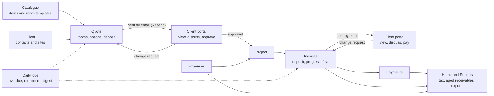
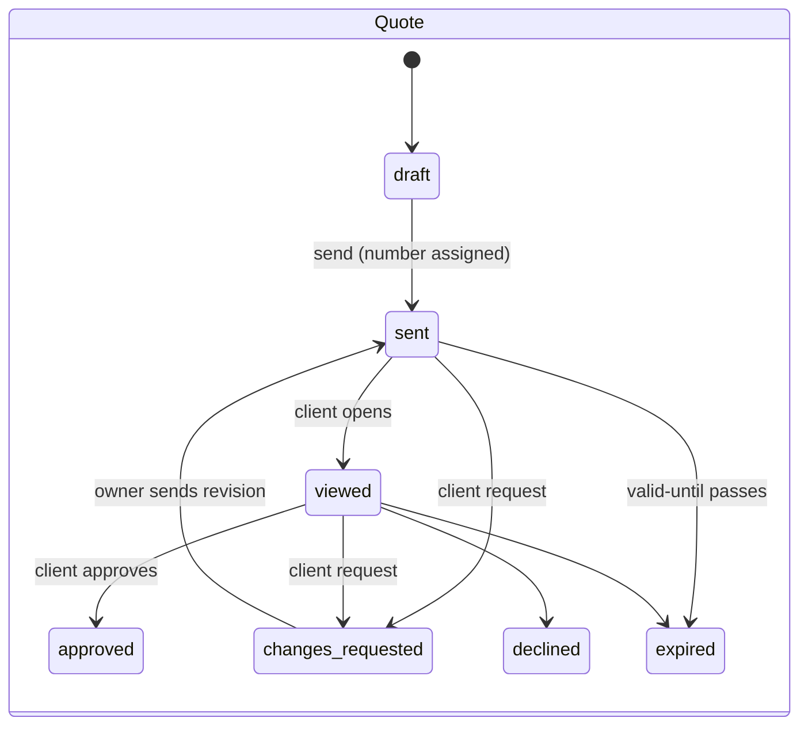
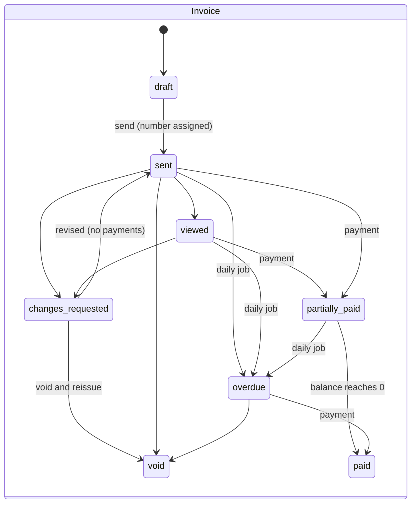
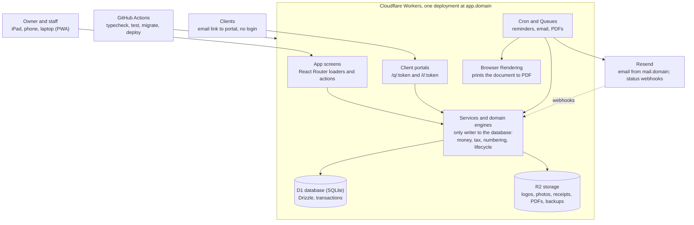

# Insides Interior Limited — Quotes & Invoicing Platform
## Complete Build Specification (Product, Design, Engineering)

**Version:** 1.0 · **Date:** October 22, 2026
**Audience:** Developer or Claude Code building the application from scratch
**Supersedes:** "Product Requirements & Build Specification" and "Product UI/UX Design Requirements" (both merged here; see Appendix A for how conflicts were resolved)

---

## 0. How to use this document

This is the single source of truth for building the application. Save it in the new repository as `docs/SPEC.md`. Every Claude Code prompt in section 14 tells Claude Code to read the relevant sections of this file, so the spec, not chat history, drives the build.

**Rules of interpretation**

1. Requirement IDs (for example `FR-QT-07`, `DS-COL-03`) are stable. Reference them in commits, pull requests and tests.
2. "Must" is version 1. "Should" is version 1 if time allows. "Could" is phase 2.
3. Where this document gives a number (a size, a colour, a duration, a limit), use it. Where it says "verify", check the current vendor documentation before relying on it.
4. The old application is kept in the new repo under `legacy/` as a read-only reference. Reuse or refactor from it only where the salvage map (section 2.5) says so, or where the salvage rule in 2.5 allows; never reuse its data layer, services or security rules.
5. Where an earlier document disagrees with this one, this one wins.

**Contents**

0.1 System at a glance
0.2 Canonical vocabulary
1. Executive summary
2. Audit of the existing application
3. Users, personas and jobs-to-be-done
4. Product scope, principles and non-goals
5. Functional requirements
6. Experience and visual design system (premium, colourful, tablet- and mobile-first)
7. Target architecture, stack and hosting
8. Data model and schema
9. Email (Resend), domain and DNS
10. PDF generation, numbering, tax and money handling
11. Security, privacy, backups and compliance
12. Data migration from the old app
13. Testing and quality strategy
14. Delivery plan, CLAUDE.md and Claude Code build prompts
15. Risks, open questions and decisions log
Appendix A. Source documents and conflict resolution

### 0.1 System at a glance

The whole product is one loop: **price it → agree it → bill it → get paid → report it.** Every module exists to move a job around that loop, and every module reads and writes through the same service layer and the same money engine, so a number shown anywhere (builder, portal, PDF, email, Home, report) is the same number.



How the layers line up, top to bottom, for every module:

| Layer | One place for it | Sections |
| --- | --- | --- |
| Words and states | Canonical vocabulary (0.2) and lifecycles (5.13) | 0.2, 5.13 |
| What it must do | Functional requirements with IDs | 5 |
| How it looks and behaves | Studio Colour design system, one component library, one document renderer | 6 |
| Where data lives | One relational schema; derived values never stored | 8 |
| How numbers are made | `app/domain` money, tax, numbering, lifecycle, diff | 10 |
| Who may do what | One permissions table; portal limited to three writes | 11 |
| How it is proven | Fixtures F1–F3, device matrix, flows 1–6 | 13 |
| How it gets built | Eleven phases with copy-ready prompts | 14 |

### 0.2 Canonical vocabulary

Use exactly these words in code, UI copy, emails, tests and commits. The old app mixed several of them; that ends here.

| Term | Means | Not |
| --- | --- | --- |
| Owner | The business owner using the app | Admin, user |
| Staff | An invited helper with limited rights | Member, assistant (in code) |
| Client | The business's customer record | Customer |
| Payer | The person acting in the portal on a client's behalf | Customer, guest |
| Catalogue item | A reusable service, product, fee or allowance | Item (alone), product (for services) |
| Room / section | A titled group of lines on a quote or invoice | Area, category |
| Line | One priced row on a document | Line item (in code), row |
| Optional item | A line excluded from the total until selected | Add-on, upsell |
| Quote | A priced proposal awaiting approval | Estimate, proposal |
| Invoice | A request for payment; kind = standard, deposit, progress or final | Bill |
| Revision | A frozen version of a sent document (rev 1, rev 2…) | Version (in UI), edit |
| Revised | An unpaid invoice re-sent under the same number as a new revision | Amended, updated |
| Void | A cancelled invoice that keeps its number | Deleted, cancelled |
| Approve / Approved | The client agreeing to a quote (or an invoice requiring approval) | Accept, accepted (Accept / Decline is reserved for the owner resolving a change request) |
| Change request | A structured ask from the payer about one line | Feedback, comment |
| Conversation / thread | The message history on one document | Chat, comments |
| Portal | The no-login client page at `/q/:token` or `/i/:token` | Public view, share page |
| Project | A job grouping quotes, invoices and expenses for one client and site | Job (in code) |
| Home | The dashboard screen | Dashboard (in UI) |
| Outstanding / Overdue / Paid | As defined in 5.11 | Due, unpaid, settled |

Statuses are exactly those in 5.13; their colours and icons are in 6.3. Nowhere else defines a status.

---

## 1. Executive summary

**Decision: rebuild the core, salvage the surface.** The current app is a well-designed prototype with a fragile core. Its data layer, security model and money math are not safe for real clients and real dollars, so they are rewritten from scratch. Its UI primitives, interaction patterns, status and empty-state copy, and product blueprint are good, so they are carried over and refactored to the new design system rather than reinvented. Section 2.5 lists the call for every part of the old code, and gives the rule for deciding anything it does not cover.

We will rebuild Insides Interior Limited's quotes and invoicing platform as a single TypeScript application with a relational database, server-side business logic, branded email through Resend on a company domain, and pixel-consistent PDFs. It must feel premium, rich in colour and effortless on an iPad or phone, because that is where the owner works: on site, with clients, between appointments.

The owner should be able to go from a site visit to a sent, client-approvable quote in under 10 minutes, and from an approved quote to a deposit invoice in one tap.

**What changes and why it matters to the business**

- **Trust in the numbers.** Money moves to integer cents, invoice numbers become sequential and gap-free, and every total is computed on the server. Today a quote total can drift by a cent and two invoices can share a number.
- **Clients get a real experience.** Quotes and invoices arrive by email from the business's own domain, open in a branded portal, and can be approved, discussed, changed or paid without a login.
- **The owner stops chasing.** Overdue reminders, quote follow-ups and payment receipts send automatically on a schedule she controls.
- **Fit to interior design.** Quotes organised by room, optional items the client can toggle, materials with markup, deposits and progress billing. The current app is generic software-agency invoicing.
- **Premium on every screen size.** A colourful, studio-quality interface designed first for iPad and phone, then scaled up to desktop.
- **Built to be maintained by one person with Claude Code.** One repo, one deploy target, typed end to end, tested, with a `CLAUDE.md` that keeps every future change consistent.

**Success measures (90 days after go-live)**

| Measure | Target |
| --- | --- |
| Time from blank to sent quote (on iPad) | under 10 minutes |
| Quotes approved online (vs. by phone or email) | 70% or more |
| Average days from invoice sent to paid | down 30% from today's baseline |
| Manual reminder emails written by the owner | zero |
| Calculation or numbering defects found by the accountant | zero |
| Owner rating of "looks and feels premium" (1–5) | 4.5 or higher |
| Monthly running cost | under US$25 excluding the domain |

**Recommended stack in one line:** Cloudflare Workers (React Router v7 full-stack) + D1 (SQLite) via Drizzle ORM + R2 file storage + Better Auth + Resend + Cron Triggers, installable as a PWA, built and maintained with Claude Code from a private GitHub repo. Section 7 explains the choice.

---

## 2. Audit of the existing application

The current build is roughly 9,300 lines of React and TypeScript across 70 files, generated in Google AI Studio and branded internally as "InvoiceOS". About 60% of the planned product works end to end; Settings and Reports are one-line placeholders, and nothing sends email.

### 2.1 What exists today

| Area | State | Notes |
| --- | --- | --- |
| Stack | Vite + React 19 SPA, Tailwind 4, React Router 7, Radix, Lucide, Recharts, Firebase Auth, Firestore, Storage | Pure client app; all business logic runs in the browser |
| Auth | Working | Email/password and Google; open `/register` page means anyone can create an account |
| Dashboard | Working | Revenue chart, action inbox, activity feed; load errors are only logged to the console |
| Quotes | Working | Builder with live preview, list, public link `/q/:token` with client Approve / Request changes |
| Invoices | Working | Builder with "sticky live PDF preview", list, drawer, public read-only link `/i/:token` |
| Payments | Working | Record full or partial payment against one invoice; read-only ledger |
| Customers, Items, Expenses | Working | CRUD; expense receipts upload to Storage |
| Settings | Placeholder | One line of code; business name, logo, tax and currency cannot be set |
| Reports | Placeholder | One line of code |
| Email | Absent | "Send" means copy a link; reminders are copied to the clipboard |
| PDF | Absent | The "PDF preview" is an HTML panel; there is no downloadable PDF |
| Visual system | Minimal | White surfaces, zinc neutrals, near-black accent, 6–12 px radii; no complete token system |
| Tests, CI | Absent | No test files, no lint in CI, no deploy pipeline |

### 2.2 What is worth keeping

- **The product thinking.** `PRODUCT_BLUEPRINT.md` has a solid screen inventory, empty/loading/error copy per screen, and sensible flows (quote to invoice conversion, partial payments, public share links).
- **The interaction model.** List + slide-over drawer, command palette, split-pane builder with live preview. These carry forward, adapted for touch.
- **The share-token idea.** Clients viewing documents without an account through an unguessable link is correct. The implementation is what changes.

### 2.3 Critical defects (block real-world use)

| # | Defect | Where | Business impact |
| --- | --- | --- | --- |
| C1 | **Silent fallback to demo data.** Every read that fails, or returns zero rows, falls back to `localStorage` seeded with fake software-agency invoices. | `lib/invoice-service.ts`, `lib/quote-service.ts` | A new account shows invoices that do not exist. A network error shows stale data as if it were current. |
| C2 | **Dual writes with swallowed errors.** Saves go to Firestore and to `localStorage`; a Firestore failure is logged and the UI reports success. | Same services | Records can exist only in one browser. Data loss is invisible until a client calls. |
| C3 | **Random document numbers.** `INV-2026-` plus a random 3-digit number. | `saveInvoice`, `saveQuote` | Collisions after a few dozen invoices; gaps and duplicates an accountant or CRA reviewer will flag. |
| C4 | **Floating-point money and split calculation paths.** Totals are JavaScript floats summed in the browser; discount handling is tracked separately from subtotal + tax. | Builders, services | Penny drift; editor, preview and dashboard can disagree; a tampered request can save any total. |
| C5 | **Unauthenticated writes from the public quote page.** Firestore rules let anyone holding a token change quote status and create notifications and activity entries. | `firestore.rules` | Approval cannot be proven; anyone with a forwarded link can approve or spam the owner. |
| C6 | **Weak share tokens.** Built from `Math.random()` and a timestamp. | Both services | Predictable compared to a cryptographic token; links never expire or revoke. |
| C7 | **Non-atomic payment recording.** Payment insert and invoice balance update are separate writes. | `recordPayment` | A dropped connection leaves a payment without a balance change, or the reverse. |
| C8 | **Wrong jurisdiction defaults.** Hard-coded 8.5% US-style sales tax, `$` with no currency, one tax rate per line. | Builders | Cannot produce a correct Manitoba invoice (GST and PST shown separately with registration numbers). |

### 2.4 Structural and experience debt

- **Denormalised totals maintained by the client.** `totalBilled` and `outstandingBalance` on customers are updated from the browser and will drift.
- **Status vocabulary disagrees** between the blueprint, the types and the rules (`pending` vs `sent_for_approval` vs `sent`; quotes have both `approved` and `accepted`).
- **Overdue is computed in the browser** at render time, so nothing can act on it (no reminder, no count when the app is closed).
- **Loading and failure states are inconsistent.** Errors are logged, not shown; a failed widget can look like a valid "$0".
- **Autosave status is not truthful.** Saves are announced before the server confirms them, and nothing prevents duplicate submissions.
- **Routes, navigation and blueprint disagree.** Notifications, activity, invoice preview and forgot-password appear in the blueprint but are not wired as routes.
- **AI-edit debris** in the repo root: eight `fix_*.cjs` / `update_*.js` regex patch scripts and a `query_db.js` that reads Firestore over REST with the API key.
- **Documented but not installed.** The architecture doc mandates Zod and react-hook-form; neither is a dependency. `@google/genai` and `express` are installed and unused.
- **Generic, not interior design.** No rooms, markup, deposits, optional items or projects. Seed data is about "Frontend Development Iteration".
- **Half-built client conversation.** The blueprint lists invoice statuses `sent_for_approval` and `changes_requested`, the types include `invoice_changes_requested` notifications, and an `invoiceRevisions` collection exists, but the invoice portal is read-only and the quote portal offers one comment box with no reply path. Section 5.14 makes this a real thread on quotes and invoices.

**Bottom line:** keep the blueprint, the UX patterns and the good UI building blocks; replace the data layer, the security model, the money engine and the hosting; refactor the visual layer onto the new design system. Section 12 covers getting real data out safely, including records that may exist only in the owner's browser.

### 2.5 Salvage map: reuse, refactor or rewrite

The old code is copied into `legacy/` in phase 0 (excluded from build, lint and tests). Each part gets one of four calls:

- **Reuse:** copy across with only import-path changes.
- **Refactor:** copy across, then change it to fit the new tokens, vocabulary and server-side data flow.
- **Reference:** read it for layout, copy or intent; write new code.
- **Rewrite:** discard and build fresh from this spec.

| Old code | Call | What happens |
| --- | --- | --- |
| `components/ui/*` (button, dialog, drawer, command, table, input, card) | **Refactor** | Already shadcn/Radix-style. Port into `app/components/ui`, replace zinc/black classes with tokens, add sizes 44/52, tinted and loading variants. Drawer becomes the responsive `Sheet` |
| `components/shared/status-badge.tsx` | **Refactor** | Keep the config-map pattern (label, icon, colours per status); switch to the 5.13 statuses, 6.3 colours and 0.2 labels |
| `components/layout/command-palette.tsx` | **Refactor** | Keep the cmdk structure; feed it server search results and the new routes; add touch entry point |
| `components/layout/app-shell, sidebar, topbar` | **Reference** | The shell is rebuilt for rail + tab bar + split view (6.2); reuse nav ordering ideas and icons only |
| `features/*/invoice-builder.tsx`, `quote-builder.tsx` | **Reference** | Good split-pane and live-preview layout ideas; rebuild with sections, optional items, server totals and truthful autosave |
| `features/*/invoice-list.tsx`, `quote-list.tsx`, `routes/customers`, `items`, `expenses`, `payments` | **Reference** | Reuse column choices, drawer flows and empty-state wording; rebuild data loading as server loaders |
| `routes/*/public-client-view.tsx` | **Reference** | Reuse content order and copy; rebuild on `DocumentRenderer` with the conversation thread |
| `routes/dashboard` | **Reference** | Keep widget set as a starting point; rebuild per 6.8 Home with per-widget states |
| `routes/design-system.tsx` | **Refactor** | Becomes the `/design` route, extended to every token and component |
| `lib/*-service.ts`, `lib/firebase/*`, `hooks/use-auth.tsx`, `protected-route.tsx` | **Rewrite** | Replaced by server services, Better Auth and route-level session checks |
| `types/index.ts` | **Reference** | Field ideas only; replaced by Zod schemas and the Drizzle schema (8) |
| `firestore.rules`, `storage.rules` | **Rewrite** | Replaced by server authorisation (11) |
| `PRODUCT_BLUEPRINT.md` | **Reuse (copy)** | Empty, loading and error copy per screen moves into components, reworded to the 0.2 vocabulary |
| `ARCHITECTURE.md`, `SCHEMA.md` | Retire | Superseded by sections 7 and 8; keep in `legacy/` for history |
| `fix_*.cjs`, `update_*.js`, `query_db.js`, `metadata.json`, `@google/genai`, `express` | **Delete** | Patch debris and unused dependencies |
| Seed/demo data | **Delete** | Never ported; tests use their own fixtures |

**Salvage rule for anything not listed.** Reuse or refactor old code only when all four are true: it is presentational or a pure function; it contains no data fetching, persistence, auth or money calculation; it can be brought onto the tokens and vocabulary in under an hour; and it has, or can quickly get, a test or a `/design` entry. Otherwise reference it and rewrite. Record any non-obvious call in `docs/decisions.md`.

---

## 3. Users, personas and jobs-to-be-done

The primary user is the owner, and every design decision is judged by whether she can do it alone, on an iPad or phone, between site visits. Clients are the second audience and never create an account.

| Persona | Who | Device and context | Core jobs | What success feels like |
| --- | --- | --- | --- | --- |
| **Owner** (primary) | Runs Insides Interior Limited; designer first, bookkeeper second | iPad on site (landscape and portrait), phone in the car, laptop in the evening | Price a project room by room, send it, get approval, bill the deposit, chase nothing | "I sent the quote from the client's living room and the deposit was in by Friday." |
| **Assistant / bookkeeper** (secondary, optional) | Family member or part-time helper | Laptop or tablet | Record payments, log expenses, prepare month-end exports | Can help without seeing or changing settings |
| **Client / payer** (external) | Homeowner or small business | Phone, from an email; sometimes a tablet on the sofa | Understand the price, choose options, ask questions, approve, pay | Beautiful, clear, no login, obvious next step |
| **Accountant** (external) | Year-end, VAT and WHT filer | Laptop, receives files | Clean revenue, tax-collected and expense figures | One export per period, no questions back |
| **Developer** (you) | Builds and maintains with Claude Code | Laptop | Ship changes safely, restore data, rotate keys | Changes are small, typed, tested and reversible |

**Jobs the owner hires this product for, in priority order**

1. When I finish a consultation, I want to turn my notes into a professional, room-by-room quote on my iPad, so the client sees value before they cool off.
2. When a client hesitates on price, I want to offer optional items they can toggle themselves, so we agree without three rounds of email.
3. When a quote is approved, I want the deposit invoice created and sent for me, so work can be scheduled.
4. When a client questions a line, I want to discuss it and send a revised document in minutes.
5. When money is owed, I want polite reminders to go out on their own.
6. When my accountant asks, I want to hand over VAT collected, WHT credits, revenue and expenses for any period in one file.

**Design constraints that follow:** touch-first (44 px minimum targets, 48 px for primary actions on tablet), no feature that only works with a keyboard or hover, readable at arm's length on site, works one-handed on a phone, and nothing irreversible without undo or confirmation.

---

## 4. Product scope, principles and non-goals

Version 1 is a complete quote-to-cash loop for one business: clients, catalogue, quotes, invoices, conversations, payments, email, PDFs, expenses and an accountant export. Anything that does not shorten that loop waits.

### 4.1 Product principles

1. **The server is the source of truth.** The browser proposes; the server validates, calculates and stores. No total, number or status is trusted from the client.
2. **Money is boring.** Integer cents, explicit currency, round once per line, immutable once sent.
3. **Sent means frozen.** A sent quote or invoice is a legal document. Changes create a new revision; history is never rewritten. A payer's change request is answered with a revision, never an edit in place.
4. **One obvious next action.** Every screen and every email has exactly one primary button.
5. **Premium and joyful, never noisy.** This is a design business and the app is part of her brand. Use colour generously to orient, group and delight, with craft in typography, spacing and motion. Colour always carries meaning or identity, never random decoration (section 6).
6. **Touch first, everywhere.** Designed for iPad and phone first; desktop adds density and keyboard power, not different features.
7. **Fail loudly, recover gently.** Errors are visible and specific; nothing pretends to have saved. Autosave and undo protect work in progress.
8. **Boring technology, one deploy.** One repo, one runtime, one database. Every dependency must earn its place.

### 4.2 In scope for v1

| Module | Included |
| --- | --- |
| Access | Owner sign-in (magic link + passkey/Google), invite one assistant, no public sign-up |
| Business settings | Legal name, logo, address, TIN and RC number, taxes, numbering, payment instructions, email templates, brand colour, appearance (Light/Dark/System) |
| Clients | Contacts, billing and site addresses, notes, history, balance |
| Catalogue | Services (hourly, fixed), products/materials with cost and markup, reusable room templates |
| Projects | Light grouping of quotes, invoices and expenses per client job |
| Quotes | Room/section structure, optional items, deposit terms, expiry, revisions, email send, client portal approve with typed name, conversation thread with line-level change requests |
| Invoices | From quote (deposit, progress, final) or blank; sequential numbering; email send; client portal with conversation, change requests and revised invoices; PDF |
| Payments | Record bank transfer, POS, cash, card, cheque; partial payments; withholding tax; receipt email |
| Reminders | Scheduled overdue reminders and quote follow-ups with owner-set cadence |
| Expenses | Log with receipt photo, category, tax paid, link to project |
| Reporting | Home KPIs, aged receivables, sales tax summary, CSV export for accountant |
| Audit | Activity timeline per document and globally |
| Install | Installable PWA on iPad, iPhone and Android with app icon and splash |

### 4.3 Phase 2 (after 60 days of real use)

- Online card and Apple/Google Pay payments via Stripe Checkout on the invoice portal.
- Recurring invoices (retainers, staging rentals).
- Credit notes and refunds.
- Mood board / image attachments on quote sections; client photo attachments in threads.
- Client portal history page (all documents for one client).
- Bank CSV import to match payments.
- Replies by email that land in the conversation thread.

### 4.4 Explicit non-goals

- **Not an accounting system.** No general ledger, payroll or bank reconciliation. QuickBooks/Xero export only if the accountant asks.
- **Not multi-tenant SaaS.** One business by design. The schema keeps `business_id` so this is not a dead end.
- **No AI features in v1.** The unused Gemini dependency is removed. A "draft line items from my notes" helper is a phase 3 candidate.
- **No native app store app.** An installable PWA covers iPad and phone.
- **No offline editing.** Read-only offline viewing of recently opened documents is acceptable; offline writes create the exact sync problems the current app has.

---

## 5. Functional requirements

Each requirement has an ID used by prompts, commits and tests.

### 5.1 Access and accounts (AUTH)

| ID | Requirement | Priority | Acceptance criteria |
| --- | --- | --- | --- |
| FR-AUTH-01 | Owner signs in with an emailed magic link (sent via Resend) or Google | Must | Link expires in 15 minutes, single use; session lasts 30 days with sliding renewal |
| FR-AUTH-02 | Owner can register a passkey for one-tap sign-in | Should | Face ID / Touch ID sign-in works on iPad and iPhone Safari and in the installed PWA |
| FR-AUTH-03 | No public registration | Must | `/register` does not exist; only the seeded owner email or an invited email can sign in |
| FR-AUTH-04 | Owner invites an assistant with role `staff` | Must | Staff cannot see Settings, delete documents, or void invoices |
| FR-AUTH-05 | Sign out everywhere and list active sessions | Should | Revoking a session logs that device out on next request |
| FR-AUTH-06 | Sign-in screens: visible labels, inline errors, loading state; distinguish "link expired", "not invited" and "service unavailable" without leaking secrets | Must | No non-functional links (e.g. "Forgot password" does not exist because there is no password) |

### 5.2 Business settings (SET)

| ID | Requirement | Priority | Acceptance criteria |
| --- | --- | --- | --- |
| FR-SET-01 | Business profile: legal name, trading name, address, phone, email, website, logo (PNG/SVG, max 2 MB) | Must | Appears on every PDF, portal page and email |
| FR-SET-02 | Tax registrations: TIN and RC (CAC) number | Must | Printed on quotes and invoices when set |
| FR-SET-03 | Tax rates as a list (name, rate, applies-to: services/products/both, default on/off) | Must | Default seeded: VAT 7.5%, off by default (switch on per line, per item or as the default when VAT-registered); add, edit, archive; archived rates stay on old documents |
| FR-SET-04 | Numbering: prefix and next number for quotes and invoices separately (e.g. `Q-1001`, `INV-1001`) | Must | Next number can only increase; preview shows the next number |
| FR-SET-05 | Defaults: payment terms (days), quote validity (days), deposit %, notes, terms and conditions | Must | New documents prefill from defaults |
| FR-SET-06 | Payment instructions: bank name, account name, 10-digit account number (NUBAN), payment note | Must | Shown on invoice portal and PDF |
| FR-SET-07 | Email templates per event with merge fields (`{client.firstName}`, `{invoice.number}`, `{amount.due}`, `{link}`) | Must | Live preview; reset to default |
| FR-SET-08 | Reminder cadence: days before/after due, maximum count, quiet hours | Must | Changes apply to future sends only |
| FR-SET-09 | Brand colour for client-facing documents and portal (picked from the logo or entered as hex) | Should | Contrast checked against WCAG AA before saving; suggests the nearest accessible shade |
| FR-SET-10 | Appearance: Light, Dark, System; app accent theme (default "Studio Teal") | Must | Preference persists per device and applies before first paint (no theme flash) |
| FR-SET-11 | Settings grouped: Business, Branding, Tax and currency, Documents, Email, Reminders, Team, Appearance, Data | Must | Unsaved-changes warning; changing tax defaults never rewrites existing documents |

### 5.3 Clients (CLI)

| ID | Requirement | Priority | Acceptance criteria |
| --- | --- | --- | --- |
| FR-CLI-01 | Create a client inline from any builder in 3 fields (name, email, phone) | Must | New client is selected and saved without leaving the builder |
| FR-CLI-02 | Client record: one or more contacts, billing address, one or more site addresses, notes, tags | Must | Site address selectable per quote |
| FR-CLI-03 | Client profile shows lifetime billed, paid, outstanding, and a timeline of documents, messages and emails | Must | Figures computed by the server from invoices and payments, never stored on the client row |
| FR-CLI-04 | Search by name, email, phone, address | Must | Results in under 300 ms for 5,000 clients |
| FR-CLI-05 | Archive (not delete) clients with documents | Must | Archived clients hidden from pickers but kept in reports |
| FR-CLI-06 | Each client gets a stable colour avatar (initials on a palette colour derived from the name) | Must | Same client, same colour, everywhere in the app |

### 5.4 Catalogue (CAT)

| ID | Requirement | Priority | Acceptance criteria |
| --- | --- | --- | --- |
| FR-CAT-01 | Item types: service (hourly or fixed), product/material, fee (e.g. delivery), allowance | Must | Type drives default tax rules, PDF grouping and its colour chip |
| FR-CAT-02 | Products carry cost, markup % and sell price; editing either recomputes the other | Must | Cost and markup are never shown to clients |
| FR-CAT-03 | Unit of measure (each, hour, sq ft, linear ft, yard, roll, set) | Must | Quantity accepts up to 3 decimals |
| FR-CAT-04 | Room templates: a named set of sections and items (e.g. "Primary bedroom refresh") | Should | Inserting a template copies items; later catalogue changes do not alter existing quotes |
| FR-CAT-05 | Item photo (product image) | Should | Shown as a thumbnail in pickers and optionally on the quote |
| FR-CAT-06 | Supplier and SKU fields on products | Could | Searchable in the picker |

### 5.5 Projects (PRJ)

| ID | Requirement | Priority | Acceptance criteria |
| --- | --- | --- | --- |
| FR-PRJ-01 | A project belongs to one client and one site address and groups quotes, invoices and expenses | Must | Approving a quote creates a project if none exists |
| FR-PRJ-02 | Project view shows contract value, invoiced, paid, remaining to bill, and expenses (gross margin) | Should | Remaining to bill = approved quote total minus invoiced |
| FR-PRJ-03 | Optional cover photo per project | Could | Shown on project cards |

### 5.6 Quotes (QT)

| ID | Requirement | Priority | Acceptance criteria |
| --- | --- | --- | --- |
| FR-QT-01 | Builder with sections (rooms/areas), each with line items; drag to reorder sections and lines | Must | Works by touch on iPad with a visible drag handle and a non-drag "Move up/down" alternative |
| FR-QT-02 | Line item: description (rich text: bold, bullets), quantity, unit, unit price, taxes, optional flag, image (Should) | Must | Totals update in under 50 ms per keystroke |
| FR-QT-03 | Optional items are excluded from the total until the client (or owner) selects them | Must | Portal shows "Base total" and "Your selection" |
| FR-QT-04 | Discount per line or per document (amount or %), shown before tax | Must | Discount never pushes a line below zero |
| FR-QT-05 | Deposit terms: none, % of total, or fixed amount | Must | Shown on quote; drives the deposit invoice |
| FR-QT-06 | Autosave drafts every 2 s of inactivity, with truthful status: "Saving…", "Saved just now", "Couldn't save — Retry" | Must | Status never says Saved before the server confirms; two tabs editing the same draft get a "newer version exists" warning |
| FR-QT-07 | Number assigned on first send, not on draft creation | Must | No gaps from abandoned drafts |
| FR-QT-08 | Send by email via Resend with PDF attached and portal link; CC/BCC; preview before send | Must | Status becomes `sent`; email event logged; send button disabled while sending |
| FR-QT-09 | Revising a sent quote creates revision 2, 3… and invalidates prior approval links | Must | Portal shows only the latest revision; history kept |
| FR-QT-10 | Client portal: view, choose options, approve with typed full name + checkbox, or request changes line by line in the quote's thread (FR-MSG) | Must | Approval records name, timestamp, IP, user agent and a hash of the exact revision approved |
| FR-QT-11 | Expiry: after valid-until date the portal shows "expired, contact us" and blocks approval | Must | Owner can extend with one tap |
| FR-QT-12 | On approval: notify owner (email + in-app), create project, offer "Create deposit invoice" | Must | Deposit invoice is a draft by default; setting can auto-send |
| FR-QT-13 | Duplicate quote; convert to invoice (full) | Must | Conversion copies only selected optional items and explains what will happen first |
| FR-QT-14 | Follow-up reminder if not viewed or not answered after N days | Should | Stops on approval, decline or expiry |
| FR-QT-15 | Optional drawn signature on the approval step when the client approves on a tablet in person | Could | Stored as SVG with the acceptance record |

### 5.7 Invoices (INV)

| ID | Requirement | Priority | Acceptance criteria |
| --- | --- | --- | --- |
| FR-INV-01 | Invoice types: standard, deposit, progress (% or amount of a quote), final (balance of a project) | Must | Final invoice lists prior deposits and progress invoices as credits |
| FR-INV-02 | Sequential, gap-free numbering assigned at send time inside a database transaction | Must | 1,000 concurrent sends in a test produce 1,000 unique consecutive numbers |
| FR-INV-03 | Issue date, due date (from terms), PO/reference, site address | Must | Due date recalculates when terms change on a draft |
| FR-INV-04 | Taxes shown per tax (e.g. VAT) with TIN; rounding per line to the kobo, half-up | Must | Matches the golden fixtures in section 10 |
| FR-INV-05 | Send by email with PDF and portal link | Must | As FR-QT-08 |
| FR-INV-06 | Sent invoices are locked. Corrections: if no payment has been recorded, send a revision under the same number marked "Revised (rev N)"; if any payment exists, void and reissue (credit notes in phase 2) | Must | Void keeps the number, marks VOID on PDF, reason required; every prior revision and PDF stays in history |
| FR-INV-07 | Status derived by the server: `draft`, `sent`, `viewed`, `changes_requested`, `partially_paid`, `paid`, `overdue`, `void` | Must | `overdue` set by a daily job using the business time zone, never by the browser |
| FR-INV-08 | Client portal: view, download PDF, see payment instructions and balance, and discuss or request changes in the invoice's thread (FR-MSG) | Must | Mobile Lighthouse score 95+ |
| FR-INV-09 | Pay online (Stripe Checkout) | Could | Phase 2 |

### 5.8 Payments (PAY)

| ID | Requirement | Priority | Acceptance criteria |
| --- | --- | --- | --- |
| FR-PAY-01 | Record payment: amount, date, method (bank transfer, POS, cash, card, cheque, other), reference, note | Must | Payment and invoice balance update in one transaction; amount defaults to the balance |
| FR-PAY-02 | Overpayment is blocked unless owner confirms it becomes client credit | Must | Credit balance visible on client |
| FR-PAY-03 | Send receipt email automatically (setting) | Must | Receipt shows amount, method, remaining balance |
| FR-PAY-04 | Delete a payment (owner only) with reason; balance recomputes | Must | Logged in activity |
| FR-PAY-05 | Payments ledger links each payment to its invoice and client | Must | Payment record and invoice status are visually distinct |
| FR-PAY-06 | Record withholding tax deducted by the client when recording a payment: rate (5%, 10% or other), amount (computed from the pre-VAT amount, editable), WHT receipt or credit-note reference | Must | Cash + WHT settles the invoice (status Paid); WHT credits listed per period in reports and exports; deleting the payment removes its WHT |

### 5.9 Reminders and automation (AUTO)

| ID | Requirement | Priority | Acceptance criteria |
| --- | --- | --- | --- |
| FR-AUTO-01 | Daily job at 08:00 Africa/Lagos marks overdue invoices and queues reminders per cadence | Must | Idempotent: running twice sends nothing twice |
| FR-AUTO-02 | Per-invoice "pause reminders" toggle | Must | Paused invoices are skipped and show a badge |
| FR-AUTO-03 | Weekly digest email to owner: overdue, awaiting approval, open change requests, expiring this week | Should | Sent Monday 07:30 |

### 5.10 Expenses (EXP)

| ID | Requirement | Priority | Acceptance criteria |
| --- | --- | --- | --- |
| FR-EXP-01 | Log expense: date, supplier, category, amount, VAT paid, project (optional), receipt photo | Must | Camera capture works on iPad, iPhone and Android; upload progress and failure are visible; success shown only after storage confirms |
| FR-EXP-02 | Mark an expense as billable and add it to a project's next invoice at cost or with markup | Should | Line links back to the expense |
| FR-EXP-03 | Receipt viewer: pinch-zoom, swipe between receipts, close with Escape or swipe down | Must | Keyboard and screen-reader accessible |

### 5.11 Home and reports (RPT)

| ID | Requirement | Priority | Acceptance criteria |
| --- | --- | --- | --- |
| FR-RPT-01 | Home: greeting, KPI cards (outstanding, overdue, paid this month, quotes awaiting answer), "Needs you" list, revenue vs expenses chart, recent activity | Must | Loads in under 1 s on 4G; each widget has its own skeleton, error and Retry; never shows "$0" while loading |
| FR-RPT-02 | Aged receivables: current, 1–30, 31–60, 61–90, 90+ | Must | Ties to the sum of open invoice balances |
| FR-RPT-03 | Sales tax report by period: taxable sales and tax collected per tax; tax paid on expenses | Must | Cash or accrual basis selectable; basis stated on screen |
| FR-RPT-04 | Revenue by month, by client, by item type | Should | Chart plus table alternative |
| FR-RPT-05 | CSV export of invoices, payments, expenses for a date range; ZIP of PDFs | Must | Opens cleanly in Excel |
| FR-RPT-06 | KPI cards are tappable and open the filtered list behind the number | Must | Filter is reflected in the URL |

Definitions used everywhere: **Invoiced** = total of sent, non-void invoices in the period. **Cash received** = payments in the period. **Outstanding** = open balances now. **Revenue** (on reports) = invoiced, pre-tax, unless the cash basis is selected. **Expenses** = expense totals excluding recoverable GST.

### 5.12 Search, notifications and audit (SYS)

| ID | Requirement | Priority | Acceptance criteria |
| --- | --- | --- | --- |
| FR-SYS-01 | Global search and command palette (Cmd/Ctrl+K with a keyboard; search button in the top bar on touch) | Must | Finds clients, quotes, invoices by number, name or amount; actions like "New quote"; destructive actions never run without confirmation |
| FR-SYS-02 | In-app notifications: quote viewed, approved, changes requested, new message, invoice viewed, email bounced | Must | Unread count in navigation |
| FR-SYS-03 | Activity log written by the server for every state change, message and email event | Must | Append-only; cannot be edited from the UI |

### 5.13 Document lifecycles

Only the server performs transitions; the state machines live in `app/domain/lifecycle.ts` with exhaustive tests. Beyond the quote diagram: `revise` takes a sent, viewed, changes-requested or expired quote back to an editable draft that keeps its number (FR-QT-09), and `extend` returns an expired quote to `sent` (FR-QT-11).





Payments recorded during `changes_requested` still update the balance. Reminders never send while a change request is open.

### 5.14 Client conversations and change requests (MSG)

Every quote and every invoice has one conversation thread shared by the owner (in the app) and the payer (in the portal, no login). The payer can ask questions or request specific changes such as removing a line, changing a quantity or swapping an item. The owner answers by accepting, declining or discussing, and accepted changes produce a revised document. Nothing the payer writes changes a document on its own.

| ID | Requirement | Priority | Acceptance criteria |
| --- | --- | --- | --- |
| FR-MSG-01 | One thread per quote and per invoice, shown below the document in the portal and beside it in the app | Must | Both sides see the same messages in order, timestamps in America/Winnipeg |
| FR-MSG-02 | Payer posts a general message from the portal (plain text, up to 2,000 characters); name asked once and remembered on that device | Must | Owner gets an in-app and email notification within 1 minute |
| FR-MSG-03 | Line-level change request: on any line the payer taps "Request a change" and picks Remove this item, Change quantity, Ask a question or Other, with a note | Must | Tied to that line and revision; shows as a card in the thread and a coloured marker on the line |
| FR-MSG-04 | Owner replies from the app; the payer receives the reply by email with a link back to the thread | Must | Reply appears in the portal and the email is logged |
| FR-MSG-05 | Owner resolves each change request: Accept, Decline (with reason) or keep discussing | Must | Accepting several requests batches them into one new draft revision; the payer sees the outcome on each card |
| FR-MSG-06 | Revisions: a quote becomes revision N+1 and is re-sent. An unpaid invoice is re-sent as "Revised (rev N)" under the same number with prior PDFs kept. An invoice with payments is corrected by void and reissue | Must | Portal shows the latest revision with a "What changed" summary: lines added, removed or changed, and total before and after |
| FR-MSG-07 | While a change request is open the document shows `changes_requested` and automatic reminders pause | Must | No overdue reminder is ever sent while a request is open |
| FR-MSG-08 | Optional per invoice: "Payer must approve before paying", for large progress invoices | Should | Portal shows Approve invoice; approval recorded like a quote acceptance |
| FR-MSG-09 | Owner Inbox lists every thread with unread messages or open change requests, filterable by client | Must | Unread count in navigation; open requests appear in Home "Needs you" |
| FR-MSG-10 | Threads are permanent, included in exports and in the activity log; the owner can hide (not delete) an abusive message | Must | Hidden messages stay in the audit trail |
| FR-MSG-11 | Payer attaches photos (e.g. "this fabric instead"), up to 5 images of 10 MB | Could | Stored privately in R2 |
| FR-MSG-12 | Payer replies to the notification email and the reply lands in the thread | Could | Needs inbound email; verify in phase 2 |

---

## 6. Experience and visual design system

**Direction: "Studio Colour."** The app should feel like walking into a beautifully styled design studio: warm, light-filled neutrals as the room, and rich, confident colour as the furnishings. Every module owns a signature colour, statuses are vivid and unmistakable, charts and avatars are full of colour, and client documents carry the business's own brand. Craft comes from Apple-like typography, spacing and motion; productivity comes from Microsoft-like navigation, search and clear data tables. This is an original design language, not a copy of either company's UI.

Colour is used generously but never randomly: **every colour means a module, a status, a category, or the brand.** If a colour carries no meaning, it does not appear.

### 6.1 Platforms and priorities (DS-PLT)

Design and test in this order. Every screen must be fully usable on all of them; none is a "lite" version.

| Priority | Device class | Viewport (CSS px) | Primary context | Navigation |
| --- | --- | --- | --- | --- |
| 1 | **Tablet landscape** (iPad, iPad Air, iPad Pro) | 1024–1366 wide | On site with clients, building quotes | Left rail (icons + labels, 248 px; collapsible to 80 px) + split view (list on left, detail on right) |
| 2 | **Tablet portrait** | 744–1024 wide | Walking a room, showing a client | Collapsed rail (80 px) + full-width content; detail opens as a large right sheet (min 70% width) |
| 3 | **Phone** (iPhone, Android) | 360–430 wide | In the car, quick checks, recording payments | Bottom tab bar (5 items) with a raised centre "+ New" button; detail screens push full screen |
| 4 | **Desktop / laptop** | 1280+ wide | Evening admin, reports, exports | Expanded left rail + split view; keyboard shortcuts and command palette |
| Small phone | 320–359 wide | Fallback | Must not break; single column, no horizontal page scroll |

**Requirements**

- **DS-PLT-01** Layout responds to available width, not device detection. Use container queries for components (cards, tables, the document preview) so they adapt inside split views.
- **DS-PLT-02** Rotation and multitasking (iPad Split View, Slide Over, Stage Manager) never lose state: open drawers, scroll position, unsaved input and the selected row survive.
- **DS-PLT-03** Respect safe areas (`env(safe-area-inset-*)`) for the notch, the home indicator and rounded corners; sticky bars sit above the home indicator.
- **DS-PLT-04** Installable PWA: manifest with name, short name, icons (maskable 512 px), `display: standalone`, splash colours, and `theme-color` that matches the canvas.
- **DS-PLT-05** Works with an iPad hardware keyboard and trackpad (hover states, pointer cursor, shortcuts) but never requires them.
- **DS-PLT-06** Apple Pencil Scribble works in every text field (use native inputs, never custom canvas text fields).

### 6.2 Navigation and app shell (DS-NAV)

Primary destinations: **Home, Quotes, Invoices, Clients, Inbox**, then **More** (Projects, Catalogue, Expenses, Payments, Reports, Settings). On phone the five tabs are Home, Quotes, **+ New**, Invoices, More; Clients and Inbox are first in More and in search, and Inbox shows its unread badge on the More tab.

- **DS-NAV-01** Each destination shows its icon, quiet when idle. The selected item gets a teal icon, a raised surface row with a teal edge marker and a bold label, so selection never relies on colour alone.
- **DS-NAV-02** The **+ New** button is always reachable: raised centre tab on phone, a prominent filled button at the top of the rail on tablet and desktop. It opens a sheet with large colourful tiles: New quote, New invoice, Record payment, Log expense, New client.
- **DS-NAV-03** The top bar shows the page title (display serif), the search button, notifications and the account avatar. On tablet it also shows contextual actions for the open record.
- **DS-NAV-04** Each module screen opens with a **module header band**: a quiet strip on the canvas closed by a hairline, carrying the title, a one-line summary ("4 awaiting answer · $18,420 out") and the primary action.
- **DS-NAV-05** Lists and details use the **split view** pattern on wide screens (list 360–420 px, detail fills the rest) and push navigation on phone. Back always returns to the same scroll position.
- **DS-NAV-06** Command palette: Cmd/Ctrl+K on a keyboard, search button on touch. Lists actions and records; arrow keys, Enter, Escape; announced to screen readers.

### 6.3 Colour system (DS-COL)

#### Neutrals (the room)

| Token | Light | Dark | Use |
| --- | --- | --- | --- |
| `canvas` | `#F8F6F2` | `#121110` | Page background (warm linen) |
| `surface` | `#FFFFFF` | `#1B1A18` | Cards, sheets, navigation |
| `surface-2` | `#F2EEE8` | `#252320` | Grouped sections, inputs, hover |
| `surface-3` | `#E9E3DA` | `#2F2C28` | Pressed / selected neutral |
| `border` | `#E4DED5` | `#36322D` | Dividers, field outlines |
| `text-primary` | `#1E1B18` | `#F5F1EA` | Main content |
| `text-secondary` | `#5C554D` | `#BDB5AA` | Labels, supporting text |
| `text-tertiary` | `#7A7268` | `#9A9187` | Metadata only; verify contrast per use |

#### Studio palette (the furnishings)

Eight signature hues. Each has a **tint** (backgrounds, bands, chips), a **base** (icons, fills, chart series, buttons), an **ink** (text on tint, guaranteed 4.5:1) and a **dark-mode** value.

| Hue | Tint | Base | Ink | Dark mode base | Module / meaning |
| --- | --- | --- | --- | --- | --- |
| Teal (brand) | `#E6F4F2` | `#0F766E` | `#0B4F4A` | `#4FD1C5` | App brand, Home, primary buttons, focus ring |
| Plum | `#F5EBF3` | `#8E3B7E` | `#5E2453` | `#E09BD3` | Quotes |
| Indigo | `#ECEEFC` | `#4453C4` | `#2C3690` | `#9AA6FF` | Invoices |
| Terracotta | `#FBEEE8` | `#C2532D` | `#8A3418` | `#F4A07F` | Clients |
| Saffron | `#FCF4DD` | `#B7800B` | `#7A5300` | `#F2C94C` | Projects |
| Sage | `#EDF4EC` | `#4E7D51` | `#2F5332` | `#9BD19E` | Catalogue |
| Rose clay | `#FBEDEF` | `#B4505F` | `#7D2E3A` | `#F2A3AE` | Expenses |
| Ocean | `#E8F2FA` | `#2563A8` | `#183F6C` | `#8EC3F5` | Reports, Payments, Inbox |

In dark mode, tints become the base colour at 14–18% opacity over `surface`, and ink becomes the dark-mode base.

#### Status colours (always with a text label, optionally an icon)

| Status | Colour | Badge style |
| --- | --- | --- |
| Draft | Slate `#64748B` | Outline badge, pencil icon |
| Sent | Indigo | Tinted badge, paper-plane icon |
| Viewed | Ocean | Tinted badge, eye icon |
| Changes requested | Saffron | Tinted badge, speech-bubble icon; matching marker on affected lines |
| Approved | Sage | Solid badge, check icon |
| Partially paid | Teal | Tinted badge with a small progress ring showing % paid |
| Paid | Sage | Solid badge, double-check icon; a brief sage "paid" stamp on the document preview |
| Due soon (≤ 7 days) | Saffron | Tinted badge, clock icon |
| Overdue | Danger `#B42332` (dark `#FF7D87`) | Solid badge, alert icon; left edge stripe on the row |
| Declined / Expired | Rose clay | Tinted badge |
| Void | Neutral grey | Outline badge, label struck through |

#### Rules

- **DS-COL-01** All colours come from tokens (CSS variables exposed as Tailwind theme values). No raw hex in components.
- **DS-COL-02** Every text/background pair meets WCAG 2.2 AA (4.5:1 for text, 3:1 for large text and UI boundaries), in light and dark, including hover, pressed, selected and disabled states. Text on a tint uses that hue's ink.
- **DS-COL-03** Colour is never the only signal: statuses carry words, charts carry labels or patterns, required fields carry text.
- **DS-COL-04** Colour is meaningful, not decorative: chrome (nav, header bands, buttons) stays neutral with a walnut primary action and teal for selection; colour goes where it carries information: KPI cards with a coloured top edge and icon, colourful category chips for item types, client avatar colours, multi-colour charts, illustrated empty states, colourful + New tiles.
- **DS-COL-05** Each KPI card uses the colour of the module it links to (Outstanding = Indigo, Quotes awaiting = Plum, Paid this month = Sage, Overdue = Danger).
- **DS-COL-06** Client avatars: initials on one of the eight bases, chosen by hashing the client name; ink text white or near-black, whichever passes contrast.
- **DS-COL-07** Gradients are allowed only as soft two-stop washes (tint → canvas) on empty states. No glass blur over content, no neon, no gradients behind body text.
- **DS-COL-08** **Client-facing documents** (portal, PDF, emails) use the business brand colour from Settings plus neutrals and status colours. The app's eight-hue palette stays inside the app so documents print cleanly and look like her brand, not ours.
- **DS-COL-09** Charts use a fixed series order: Teal, Plum, Indigo, Terracotta, Saffron, Sage, Rose clay, Ocean. Revenue is always Teal and expenses always Rose clay, on every chart.

### 6.4 Typography (DS-TYP)

| Style | Font | Size / line height (tablet & desktop) | Phone | Weight | Use |
| --- | --- | --- | --- | --- | --- |
| Display | Fraunces (variable serif) | 28 / 1.15 | 24 | 500 | Home greeting, document titles |
| Page title | Fraunces | 24 / 1.2 | 21 | 500 | Module and record titles |
| Section title | Inter | 16 / 1.35 | 16 | 600 | Card and section headings |
| Body | Inter | 14 / 1.5 | 15 | 400 | Main content; text fields stay 16 px on touch screens (iOS zoom) |
| Compact body | Inter | 13 / 1.45 | 14 | 400–500 | Dense tables on desktop only |
| Label | Inter | 12 / 1.4 | 12 | 600 | Form labels, metadata |
| KPI value | Inter, tabular figures | 28 / 1.1 | 24 | 650 | Key totals |
| Micro | Inter | 11 / 1.4 | 11 | 500 | Badges, helper text (never essential instructions alone) |

- **DS-TYP-01** Fallback stack: `Inter, -apple-system, BlinkMacSystemFont, "Segoe UI", sans-serif`; serif fallback `Georgia, serif`. Self-host both fonts (subsetted WOFF2, `font-display: swap`).
- **DS-TYP-02** Tabular numerals (`font-variant-numeric: tabular-nums`) everywhere money or quantities appear; amounts right-aligned in tables.
- **DS-TYP-03** Text scales with the user's browser/OS text size up to 200% without hiding actions.

### 6.5 Spacing, shape and elevation (DS-SPC)

- **DS-SPC-01** 4 px base scale: 4, 8, 12, 16, 20, 24, 32, 40, 48, 64.
- **DS-SPC-02** Page gutters: 32 px desktop, 24 px tablet, 16 px phone. Card padding 20–24 px; compact panels 16 px.
- **DS-SPC-03** Control heights: 44 px standard on all touch devices, 48–52 px for primary actions on tablet and phone, 40 px allowed on desktop only. Minimum touch target 44 × 44 px with at least 8 px between targets.
- **DS-SPC-04** Radii: 10 px controls, 16 px cards, 20 px sheets and the + New tiles, full pill only for badges and segmented controls.
- **DS-SPC-05** Elevation: 1 px border plus one soft shadow (`0 1px 2px rgb(30 27 24 / 6%), 0 8px 24px rgb(30 27 24 / 6%)`) for cards; a stronger single shadow for sheets and popovers. Never stack shadows on adjacent panels.
- **DS-SPC-06** Content max width 1440 px for data-heavy pages; the document preview is a fixed paper ratio (US Letter) that scales to fit.

### 6.6 Motion (DS-MOT)

Motion makes the app feel alive and premium while explaining change. It never delays an action or makes a number uncertain.

| Token | Duration | Use |
| --- | --- | --- |
| `motion-fast` | 120 ms | Hover, press, toggle |
| `motion-standard` | 180 ms | Chips, menus, small state changes |
| `motion-panel` | 260 ms | Sheets, drawers, split-view detail |
| `motion-page` | 220 ms | Route content transition (app shell stays still) |
| `motion-chart` | 400 ms | First reveal of a chart only |
| `motion-celebrate` | 900 ms | Quote approved / invoice paid moment |

- **DS-MOT-01** Easing: ease-out for entrances (`cubic-bezier(0.2, 0.8, 0.2, 1)`), ease-in-out for state changes. Animate `transform` and `opacity` only.
- **DS-MOT-02** Buttons compress to 0.98 on press; selected nav chip slides between items; sheets slide up on phone and in from the right on tablet with a backdrop fade.
- **DS-MOT-03** Totals change by cross-fading to the new value, never by counting up.
- **DS-MOT-04** Meaningful moments get a small, joyful touch: a sage "Approved" stamp and a short confetti burst in brand colours when a client approves a quote; a "Paid" stamp when an invoice is fully paid. Both can be turned off in Settings and are skipped under reduced motion.
- **DS-MOT-05** Respect `prefers-reduced-motion: reduce`: remove movement, scaling, confetti and chart animation; keep instant state changes.
- **DS-MOT-06** Skeletons match the final layout geometry; a gentle shimmer in the module tint, or static under reduced motion.

### 6.7 Touch, input and ergonomics (DS-TCH)

- **DS-TCH-01** Money and quantity fields use `inputmode="decimal"`; phone fields `inputmode="tel"`; email fields `type="email"`, so the right keyboard appears.
- **DS-TCH-02** Primary actions sit in the thumb zone on phone (bottom sticky bar) and in a sticky header or footer on tablet; the quote/invoice total bar is always visible while editing.
- **DS-TCH-03** List rows support swipe actions on touch (e.g. Record payment, Send reminder, Duplicate) and always offer the same actions through a visible "…" menu.
- **DS-TCH-04** Drag to reorder uses a visible handle with a 44 px target; long-press is never the only way to do anything.
- **DS-TCH-05** Bottom sheets on phone have a grab handle, close on swipe down and on a visible Close button; on tablet they become right-side sheets.
- **DS-TCH-06** Forms keep labels visible above fields (placeholders are examples only), show errors next to the field, scroll the first error into view, and never lose typed data on error.
- **DS-TCH-07** The on-screen keyboard never covers the focused field or the primary action (use the visual viewport API to keep them in view).
- **DS-TCH-08** Every async action disables its button and shows progress within 100 ms, preventing duplicate submissions.

### 6.8 Screen-by-screen requirements (DS-SCR)

**Home** (Teal). Greeting card with the date and a soft teal-to-plum wash. Row of four colourful KPI cards (tappable to the filtered list). "Needs you" list mixing overdue invoices, open change requests, quotes awaiting answer and drafts, each with a coloured status badge and one action button. Revenue vs expenses chart (Teal vs Rose clay) with period selector and table alternative. Recent activity with client avatars and relative times. Tablet landscape: two columns (KPIs + Needs you left, chart + activity right). Phone: single column in that order. A new account sees a welcoming illustrated empty state with three setup steps (Business details, Add your first client, Create your first quote).

**Quotes list** (Plum) and **Invoices list** (Indigo). Header band with summary and + New. Status segmented control with counts (All, Draft, Sent, Changes requested, Approved / Paid, Overdue). Search and filters grouped. Phone: cards showing client avatar, number, amount, status and due/expiry. Tablet and desktop: table with number, client, dates, total, balance (invoices), status, and a "…" menu; tapping a row opens the detail in the split view. Empty states distinguish "nothing yet" from "no results for these filters".

**Quote / invoice builder.** Header: back, number or "Draft", status badge, autosave status, Preview, primary Send.
- Tablet landscape: editor 58% left, live document preview 42% right (sticky, scales the paper).
- Tablet portrait and phone: segmented **Edit | Preview** control at the top; a sticky bottom total bar shows Subtotal, Tax and Total and opens a breakdown sheet.
- Client picker: searchable combobox with avatars and "Create '<name>'".
- Sections are coloured cards with the room name in the display serif; lines show item-type chips (service Teal, product Sage, fee Saffron, allowance Ocean). Optional items carry a dotted outline and an "Optional" chip.
- Add line opens a catalogue sheet with photos, search and recent items; custom lines allowed.
- Totals card: subtotal, discounts, each tax on its own line with its rate, total, deposit and balance due, all from the shared domain functions.
- Leaving with unsaved changes asks for confirmation unless the draft is safely saved.

**Document detail** (quote or invoice after sending). Document preview, a coloured status timeline (sent → viewed → approved/paid), payments list, conversation thread panel (right column on tablet landscape, a tab on smaller screens), and one primary action: Record payment, Send reminder, or Send revision depending on state.

**Inbox** (Ocean). Threads with client avatar, document number, last message preview, unread dot and change-request count. Selecting a thread shows the conversation with change-request cards (Saffron) offering Accept, Decline and Reply.

**Clients** (Terracotta). Directory with avatars, outstanding balance and last activity. Profile: header with large avatar and balance, tabs for Documents, Projects, Messages, Notes, Activity; primary action "New quote for this client".

**Projects** (Saffron). Cards with optional cover photo, client, contract value and a three-colour progress bar (invoiced Indigo, paid Sage, remaining neutral). Primary action "Create next invoice".

**Catalogue** (Sage). Grid of item cards with photos on tablet, list on phone; cost, markup and price; room templates as large colourful tiles.

**Expenses** (Rose clay). "Log expense" opens the camera first on touch devices; list with receipt thumbnails and category chips; receipt viewer per FR-EXP-03.

**Payments** (Ocean). Ledger with date, client, invoice, method icon, amount; tap opens the invoice.

**Reports** (Ocean). Each report opens with the question it answers, the period and the basis (cash or accrual). Charts with direct labels, exact-value tooltips and a table toggle; Export button always visible.

**Settings.** Grouped list on the left (or a list screen on phone), form on the right; live preview of the brand colour on a sample document; Appearance shows Light / Dark / System with miniature previews.

**Client portal** (`/q/:token`, `/i/:token`). No app navigation. Business logo and brand colour header, document title in the display serif, big clear total and status, the document, then a sticky action bar: Approve (quotes) or Download PDF / How to pay (invoices). Conversation thread below the document; tapping a line offers "Request a change". Expired or invalid links show a friendly message that reveals nothing about the record. Must look beautiful on a phone first.

**Sign-in.** Full-bleed soft gradient in brand colours, logo, one email field, "Email me a sign-in link", "Continue with Google", and passkey when available.

### 6.9 Key flows

1. **Quote on site (under 10 minutes, iPad).** + New → Quote → pick or create client → add room section → add items from catalogue or a room template → mark optional items → review sticky total → Send → email preview → Send. Draft autosaves throughout.
2. **Client approves (phone).** Email → portal → toggle options → total updates → type name, tick "I agree to the terms" → Approve → confirmation with deposit next step. Owner gets email and in-app notification within 1 minute.
3. **Deposit to final.** Notification → Create deposit invoice (prefilled) → Send. Later: Project → Create progress invoice (%) → Send. Finally: Create final invoice (auto-credits prior invoices) → Send.
4. **Get paid.** Bank transfer arrives → Invoice → Record payment (prefilled to balance) → Save → receipt emails automatically.
5. **Month end.** Reports → Sales tax → pick month → Export CSV + PDFs ZIP → send to accountant.
6. **Payer asks for a change.** Payer opens the invoice → taps a line → Request a change → Remove this item + note → Send. Owner gets email and Inbox badge → opens thread → Accept → draft revision opens with the line removed and totals recalculated → Send revised invoice. Payer receives "Revised (rev 2)" with a What changed summary; reminders resume. Same flow on quotes before approval.

### 6.10 The document is the product (DS-DOC)

Quotes and invoices are rendered by **one React component tree** used in three places: the builder preview, the client portal and the PDF. What the owner sees is exactly what the client sees and what prints.

Layout: logo and business block top-left; document title and number top-right in the display serif; client and site address block; sections with room headings; line table (description, qty, unit, price, amount); optional items in an "Options" block; totals with each tax on its own line and registration numbers; deposit and payment instructions; terms; approval block. The brand colour appears in the header rule, section headings and totals band. Print CSS sets US Letter, margins, repeating table headers and "Page 1 of 2" footers. Status stamps (PAID, VOID, REVISED) appear as tasteful diagonal stamps on the PDF.

### 6.11 Component system (DS-CMP)

Built on **shadcn/ui** (Radix primitives + Tailwind), owned in the repo, themed entirely by tokens. Build and test these before page work:

`AppShell` (rail / tab bar / split view) · `ModuleHeader` (gradient band) · `PageHeader` · `Button` (primary, secondary, tinted, ghost, destructive, loading, disabled; sizes md 44 / lg 52) · `IconChip` · `TextField` · `MoneyField` (cents-aware, `en-CA` formatting) · `QuantityField` · `DateField` · `Select` · `Combobox` (with Create) · `Textarea` · `RichTextLine` (Tiptap, bold and bullets only) · `StatusBadge` · `ItemTypeChip` · `Avatar` (hashed colour) · `KpiCard` · `ChartPanel` (legend, tooltip, table fallback) · `DataTable` (TanStack; sort, filter, keyboard, responsive card mode) · `SwipeRow` · `DragList` (dnd-kit) · `Sheet` (bottom on phone, right on tablet) · `Dialog` · `ConfirmDialog` · `Toast` (with Undo) · `SaveStatus` · `EmptyState` (illustration + one action) · `ErrorState` (message + Retry) · `Skeleton` · `SegmentedControl` · `ThreadPanel` · `ChangeRequestCard` · `DocumentRenderer` · `MoneyText` · `DateText` · `CommandPalette` · `Celebration`.

A `/design` route (owner and developer only) shows every component, state and token in light and dark for visual QA.

Keep layers separate: domain calculation in `app/domain`, writes in `features/*/service.ts`, reusable UI in `components/`, page composition in routes.

### 6.12 Accessibility (DS-A11Y)

- WCAG 2.2 AA baseline in light and dark.
- Every control is reachable and operable by keyboard and by touch; focus is always visible (2 px Teal ring with 2 px offset).
- Dialogs and sheets trap focus, close with Escape and restore focus on close.
- Inputs have programmatic labels; errors are linked to fields and announced.
- Save results, validation errors, new messages and status changes are announced through a polite live region.
- Charts have a text summary and a data table.
- Status is never conveyed by colour alone.
- Works with VoiceOver on iPad and iPhone and TalkBack on Android.
- Zoom to 200% without loss of function or two-dimensional scrolling in forms.

### 6.13 Performance budgets (DS-PERF)

- Portal pages: under 150 KB JavaScript (gzipped) on first load; Lighthouse mobile 95+.
- App: Lighthouse mobile 90+; interaction to next paint under 200 ms on a mid-range phone; route-level code splitting for builder, reports and charts.
- Images: logo and item photos served resized from R2 (WebP/AVIF), lazy-loaded below the fold.
- No layout shift from fonts, images, charts or skeletons (reserved dimensions).

### 6.14 Design definition of done

A screen is done only when it uses tokens and shared components; works in Light, Dark and System; is verified on iPad landscape, iPad portrait, iPhone, a small Android phone and desktop; has loading, empty, error and success states; supports keyboard and screen reader; respects reduced motion; takes all numbers from the shared domain functions; prevents duplicate submissions; has no placeholder controls or dead links; and has been tried by the owner on her own iPad.

---

## 7. Target architecture, stack and hosting

One full-stack TypeScript application deployed to Cloudflare's edge, with a relational database, object storage, scheduled jobs and Resend for email. It runs comfortably inside free or near-free tiers at this business's volume.



Browsers never talk to the database: owner screens and client portals both go through the service layer, and scheduled jobs reuse the same services to send email and render PDFs.

### 7.1 Stack decisions

| Layer | Choice | Why |
| --- | --- | --- |
| Language | TypeScript (strict) everywhere | One language for UI, API, jobs, tests |
| App framework | React Router v7 (framework mode) on Cloudflare Workers | Server loaders and actions keep business logic on the server; one deploy for app, API and portals |
| UI | React 19, Tailwind CSS 4, shadcn/ui, Lucide, Fraunces + Inter | Token-driven design system from section 6 |
| Forms and validation | Zod schemas shared by client and server; Conform or react-hook-form | One schema validates the form, the action and the insert |
| Database | Cloudflare D1 (SQLite) with Drizzle ORM and migrations | Relational integrity, transactions for numbering and payments, typed queries |
| File storage | Cloudflare R2 | Logos, item photos, receipts, cached PDFs; private bucket, signed URLs |
| Auth | Better Auth (magic link, Google, passkey plugins) on D1 | Self-hosted, sessions in our database |
| Email | Resend (REST API + React Email templates + webhooks) | Branded sending from the company domain, delivery and bounce events |
| PDF | Cloudflare Browser Rendering prints the portal document route; cached in R2 by revision hash | Same component tree as preview and portal; phase 0 spike with fallback (section 10.4) |
| Scheduled jobs | Cloudflare Cron Triggers | Reminders, overdue marking, digest, backups |
| Background work | Cloudflare Queues (or `ctx.waitUntil` at first) | Email and PDF work off the request path |
| Charts | Recharts (or visx) themed with DS-COL-09 | Accessible tooltips and table fallback |
| Drag and drop | dnd-kit | Touch-friendly reordering |
| Rich text | Tiptap with bold and bullet marks only | Sanitisable, small |
| PWA | Web app manifest + a small service worker (cache app shell and recently viewed documents, read-only) | Install on iPad and phone |
| Observability | Workers Logs + Sentry (free tier) | Errors with release tags |
| CI/CD | GitHub Actions: typecheck, lint, test, migrate, deploy with Wrangler; preview deploy per pull request | Nothing reaches production untested |
| Domain and DNS | DNS on Cloudflare | App at `app.<domain>`, email from `mail.<domain>` (section 9) |

### 7.2 Alternatives considered

| Option | Verdict | Reason |
| --- | --- | --- |
| Keep Firebase, add Cloud Functions | Rejected | Fixes email but keeps a document store for relational, transactional data; security rules remain the hardest part to get right |
| Next.js on Vercel + Neon Postgres + Vercel Cron | Strong runner-up | Excellent DX; more vendors, free-tier limits on cron and functions |
| Supabase + Vite SPA | Viable | Row-level security becomes the new firestore.rules and logic drifts back to the client |
| Cloudflare Workers + D1 + R2 | **Chosen** | One platform, one bill, transactions, fast portals, low cost, existing familiarity |

If D1 ever becomes a constraint, Drizzle makes a move to Postgres a contained migration, not a rewrite.

### 7.3 Code organisation

```
app/
  routes/            # (app) authed screens, q.$token, i.$token, api.*, design
  components/ui/     # shadcn primitives themed by tokens
  components/doc/    # DocumentRenderer shared by preview, portal and PDF
  components/shell/  # AppShell, rail, tab bar, split view, ModuleHeader
  styles/tokens.css  # colour, type, spacing, motion tokens (light + dark)
  features/          # quotes, invoices, payments, clients, catalogue, projects,
                     # expenses, reports, messages, settings
    <feature>/schema.ts     # Zod schemas
    <feature>/service.ts    # Server-only business logic (the only code that writes)
    <feature>/ui/           # Feature components
  domain/
    money.ts         # Cents arithmetic, rounding, formatting
    tax.ts           # Tax calculation engine
    numbering.ts     # Transactional sequence allocation
    lifecycle.ts     # Quote and invoice state machines
    diff.ts          # Revision "What changed" summaries
  server/
    db/schema.ts     # Drizzle schema; db/migrations/
    auth.ts          # Better Auth config
    email/           # Resend client, React Email templates, webhook handler
    pdf.ts           # Browser Rendering + R2 cache
    jobs/            # daily.ts, weekly.ts, backup.ts
    audit.ts         # Activity log writer
public/manifest.webmanifest, icons/
tests/               # unit (vitest), integration (miniflare), e2e (Playwright)
docs/SPEC.md         # this document
CLAUDE.md            # rules for Claude Code (section 14.3)
```

### 7.4 Non-negotiable engineering rules

1. Only `features/*/service.ts` writes to the database, and every write goes through a Zod-validated input.
2. Every route loader and action checks the session and the role. Portal routes check the token only and can perform exactly three writes: approve, post a message, raise a change request.
3. Money is integer cents in the database and in code; formatting happens only at the edge of the UI.
4. Any operation touching more than one row runs in a D1 batch/transaction.
5. Secrets live in Wrangler secrets, never in the repo or the client bundle.
6. No feature merges without tests for its domain logic.
7. No raw colours, font sizes or spacing values in components; tokens only.

---

## 8. Data model and schema

A normalised relational schema of about 30 tables (six owned by Better Auth) replaces the 13 Firestore collections. Totals the old app stored and patched from the browser are now computed in queries or written only by the server in the same transaction as their source rows.

### 8.1 Conventions

- Primary keys: `text` IDs generated server-side as prefixed ULIDs (`cli_…`, `qte_…`, `inv_…`).
- Every business table has `business_id`, `created_at`, `updated_at` (UTC ISO strings) and `created_by`.
- Money: `*_cents integer NOT NULL`, plus `currency text NOT NULL` on documents (NGN, written explicitly; the legacy column default is never relied on).
- Rates: basis points as integers (5% = `500`). Quantities: thousandths as integers (`qty_milli`).
- Soft delete via `archived_at` for clients, items and tax rates; hard delete only for drafts.
- Sent documents are immutable: content lives in a `*_revision` row with a `content_hash`; the parent row points to the current revision.

### 8.2 Tables

| Table | Purpose | Key columns |
| --- | --- | --- |
| `business` | The one business | legal_name, trading_name, address, phone, email, logo_key, tin, rc_number, timezone, currency, brand_color |
| `user`, `session`, `account`, `verification`, `passkey` | Better Auth | `user.role` in (`owner`, `staff`) |
| `user_preference` | Per-user UI settings | user_id, theme (`light`/`dark`/`system`), celebrations_enabled, density |
| `settings` | Defaults and automation | payment_terms_days, quote_valid_days, default_deposit_bp, default_notes, default_terms, etransfer_email, reminder_cadence (JSON), auto_send_receipts |
| `tax_rate` | VAT etc. | name, rate_bp, applies_to, is_default, archived_at |
| `sequence` | Numbering | kind (`quote`/`invoice`), prefix, next_value |
| `client` | A client of the business | display_name, company, email, phone, billing_address (JSON), notes, tags, email_bounced_at, archived_at |
| `client_contact` | Extra people | client_id, name, email, phone, role, is_primary |
| `site` | Job addresses | client_id, label, address (JSON) |
| `item` | Catalogue | type, name, description, unit, cost_cents, markup_bp, price_cents, default_tax_ids (JSON), photo_key, supplier, sku, archived_at |
| `room_template` / `room_template_line` | Reusable sections | name, color; template_id, item_id, qty_milli, position |
| `project` | Job grouping | client_id, site_id, name, status, source_quote_id, cover_photo_key |
| `quote` | Header | client_id, project_id, site_id, number (null until sent), status, current_revision_id, valid_until, share_token_hash, follow_up_paused |
| `quote_revision` | Frozen content | quote_id, revision_no, content (JSON: sections, lines, options, discounts, notes, terms), subtotal_cents, discount_cents, tax_cents, total_cents, deposit_type, deposit_value, content_hash, sent_at |
| `quote_acceptance` | Proof of approval | quote_revision_id, selected_option_line_ids (JSON), signer_name, signer_email, signature_svg, accepted_total_cents, ip, user_agent, content_hash, accepted_at |
| `invoice` | Header | client_id, project_id, quote_id, kind (`standard`/`deposit`/`progress`/`final`), number, status, issue_date, due_date, current_revision_id, share_token_hash, reminders_paused, requires_approval, voided_at, void_reason |
| `invoice_revision` | Frozen content | as `quote_revision` plus credits_cents |
| `invoice_line` | Lines of the current revision for reporting | invoice_id, description, qty_milli, unit, unit_price_cents, discount_cents, line_total_cents, item_type |
| `invoice_line_tax` | Tax per line per rate | invoice_line_id, tax_rate_id, rate_bp, taxable_cents, tax_cents |
| `payment` | Money received | invoice_id, client_id, amount_cents, method, reference, received_on, note, deleted_at, delete_reason |
| `client_credit` | Overpayments | client_id, amount_cents, source_payment_id, applied_to_invoice_id |
| `expense` | Costs | date, supplier, category, amount_cents, vat_cents, project_id, billable, receipt_key, billed_invoice_line_id |
| `conversation` | One thread per quote or invoice | entity_type, entity_id, last_message_at, owner_unread, client_unread |
| `message` | Thread entries | conversation_id, author (`owner`/`staff:<id>`/`client`), client_name, body, revision_id, attachment_keys (JSON), hidden_at, created_at |
| `change_request` | Structured payer asks | conversation_id, message_id, revision_id, line_ref, kind (`remove`/`quantity`/`question`/`other`), proposed_qty_milli, status (`open`/`accepted`/`declined`), resolution_note, resolved_in_revision_id |
| `email_message` | Every email | entity_type, entity_id, template, to, cc, subject, resend_id, status (`queued`/`sent`/`delivered`/`opened`/`bounced`/`complained`), error |
| `portal_event` | Portal views | entity_type, entity_id, event (`viewed`/`downloaded`/`option_changed`), ip, user_agent, at |
| `notification` | In-app alerts | user_id, type, entity_type, entity_id, read_at |
| `activity` | Append-only audit log | actor (`user:<id>`/`client`/`system`), entity_type, entity_id, action, data (JSON), at |
| `job_run` | Cron idempotency | job, run_key (e.g. `daily:2026-10-22`), started_at, finished_at, result |

### 8.3 Derived values (never stored on the parent)

- **Invoice balance** = current revision total − non-deleted payments − applied credits.
- **`paid` / `partially_paid`** recomputed in the same transaction that inserts or deletes a payment.
- **Client outstanding and lifetime billed** are SQL aggregates exposed through a view.
- **Overdue** is set by the daily job (status column) so it can drive reminders, and cleared by a payment.

### 8.4 Share tokens

32 random bytes from `crypto.getRandomValues`, base64url-encoded (43 characters). Only a SHA-256 hash is stored. Tokens rotate when a document is revised or voided, and the owner can revoke a link.

---

## 9. Email (Resend), domain and DNS

Buy one domain, host its DNS on Cloudflare, serve the app from a subdomain, and send all mail through Resend from a dedicated sending subdomain. Replies go to the owner's real inbox.

### 9.1 Domain plan

| Item | Recommendation | Notes |
| --- | --- | --- |
| Domain | A `.com.ng` or `.ng` matching the business (via a NiRA-accredited registrar), or a `.com` | Not bought yet; until then email only reaches the Resend account owner (section 9) |
| DNS host | Cloudflare (free) | Required for Workers custom domains |
| App | `app.<domain>` | Owner app and client portals |
| Marketing site (optional) | `<domain>` root | Can be a single page later |
| Sending | `mail.<domain>` verified in Resend | Keeps sending reputation separate |
| From | `Insides Interior <hello@mail.<domain>>` | Display name is the business |
| Reply-To | Owner's real inbox (existing or `studio@<domain>`) | Clients reply to a human |
| Inbound (optional) | Cloudflare Email Routing forwarding `studio@<domain>` | Root MX stays free |

### 9.2 DNS records (Resend shows exact values)

| Type | Name | Purpose |
| --- | --- | --- |
| MX | `send.mail` (as shown by Resend) | Bounce handling for the sending subdomain |
| TXT | `send.mail` | SPF |
| TXT | `resend._domainkey.mail` | DKIM |
| TXT | `_dmarc` | DMARC: start `p=none; rua=mailto:dmarc@<domain>`, move to `p=quarantine` after 30 clean days |
| Worker custom domain | `app` | Set by the Workers custom domain binding |

### 9.3 Sending architecture

1. A service function (e.g. `sendQuote`) renders a **React Email** template with the business brand colour and logo, attaches the PDF from R2, and enqueues the message.
2. The queue consumer calls Resend with an **idempotency key** `<entity>:<revision>:<template>` so retries never double-send.
3. The Resend ID is stored on `email_message` with status `sent`.
4. `/api/webhooks/resend` verifies the Svix signature, updates status (`delivered`, `opened`, `bounced`, `complained`), writes activity, and notifies the owner on bounce.
5. Bounced addresses are flagged on the client; the builder warns before the next send.

### 9.4 Templates (v1)

| Template | Trigger | Primary button |
| --- | --- | --- |
| Sign-in link | Owner or staff requests sign-in | Sign in |
| Quote sent | Owner sends or re-sends a quote | View your quote |
| Quote follow-up | Cadence, not answered | Review your quote |
| Quote approved (to client) | Client approves | View approved quote |
| Quote approved / changes requested (to owner) | Client action | Open quote |
| Invoice sent | Owner sends an invoice | View invoice |
| Payment reminder (before, on, after due ×N) | Daily job | View and pay |
| Payment receipt | Payment recorded | View receipt |
| New message or change request (to owner) | Payer posts in a thread | Open conversation |
| Owner reply (to payer) | Owner replies or resolves a request | View conversation |
| Revised quote or invoice | Owner sends a revision | See what changed |
| Weekly digest (to owner) | Monday 07:30 | Open Home |
| Bounce alert (to owner) | Resend webhook | Fix email address |

Emails are premium and on-brand: logo, brand-colour header rule, the display serif for the headline, one large button (48 px tall, full width on phone), a plain-text part, and the business address in the footer. Test in light and dark mail clients (Apple Mail, Gmail app, Outlook). Amounts in an email always match the attached PDF because both render from the same revision.

### 9.5 Volume and cost

Expected volume is well under 500 emails a month, which fits Resend's free tier at the time of writing (approximately 3,000 a month with a daily cap; confirm current limits before launch). Domain cost is roughly CAD $15–25 a year.

---

## 10. PDF generation, numbering, tax and money handling

These engines are where invoicing apps earn or lose trust, so each is a small, pure, exhaustively tested module in `app/domain/` with no UI or database code.

### 10.1 Money

- All amounts are integer cents; quantities are integer thousandths (`qty_milli`), so 4.5 yards is `4500`.
- Line amount = `round_half_up(qty_milli × unit_price_cents / 1000)`.
- Rounding happens once per line per tax; document totals are sums of rounded values, so the PDF always adds up.
- Display uses `Intl.NumberFormat('en-NG', { style: 'currency', currency: 'NGN' })` (₦121,950.56). `*_cents` columns hold kobo.
- Disallowed: floats for money, `toFixed` for calculation, client-submitted totals.

### 10.2 Tax engine

Each line carries zero or more tax rate IDs (defaulted from the catalogue item, editable per line). Document-level discounts are allocated across lines pro rata by line amount before tax, with the rounding remainder on the largest line.

```
tax(line, rate) = round_half_up((amount(line) − discount(line)) × rate)
total           = Σ (amount − discount) + Σ tax(line, rate)
```

**Golden fixtures (must pass exactly).** Naira, VAT 7.5% on both lines (VAT is switched on for these lines; it is off by default).

| Fixture | Lines | Subtotal | VAT | Total |
| --- | --- | --- | --- | --- |
| F1 Quote | Design consultation 3 h × ₦25,000.00 = ₦75,000.00; Drapery fabric 4.5 m × ₦8,542.75 = ₦38,442.375 → ₦38,442.38 | ₦113,442.38 | ₦8,508.18 | ₦121,950.56 |
| F2 Deposit invoice (50% of F1) | 50% of each line pre-tax | ₦56,721.19 | ₦4,254.09 | ₦60,975.28 |
| F3 Final invoice (F1 less F2) | Full lines minus deposit credit ₦56,721.19 and its VAT | ₦56,721.19 | ₦4,254.09 | ₦60,975.28 |

F2 + F3 = ₦121,950.56 exactly: rounding differences always land on the final invoice. VAT is per line (₦5,625.00 + ₦2,883.18). The engine also keeps two-rate fixtures (5% and 7%) in its unit tests to prove rounding across several taxes. Which services attract VAT is for the accountant (section 15), which is why tax applicability is per item.

**Withholding tax (WHT).** Corporate and government clients may deduct WHT (commonly 5% or 10%) before paying. WHT is not a tax the business charges, so it never changes a document's total: it is recorded against the invoice as a settlement alongside cash (FR-PAY-06), and the deducted amount is reported as a WHT credit for the accountant.

### 10.3 Numbering

- Separate sequences for quotes and invoices with owner-set prefix and starting number (so numbering continues from the old app).
- Allocation happens in the same D1 transaction that moves a document from `draft` to `sent`. A unique index on `(business_id, kind, number)` is the final guard.
- Drafts have no number; voided invoices keep theirs; revised invoices keep theirs and show "Revised (rev N)".

### 10.4 PDF generation

- **Primary:** print the portal document route (`/i/:token?print=1`) with Cloudflare Browser Rendering using the print CSS from DS-DOC.
- **Caching:** store in R2 under `pdf/<entity>/<revision>/<content_hash>.pdf`; re-downloads and attachments reuse it. New revision or stamp = new file.
- **Phase 0 spike:** prove fonts, logo and a 3-page quote render in under 5 s on the chosen plan. If not, fall back to `@react-pdf/renderer` with a template sharing tokens and data shape.
- **File name:** `Insides-Interior-INV-1042.pdf` (plus `-rev2` for revisions).
- Selectable text, never an image of text; tagged PDF where supported.

---

## 11. Security, privacy, backups and compliance

Authenticated users act through server code that checks their role; anonymous clients act only through a hashed, revocable token that permits exactly three kinds of write: approve, post a message, raise a change request. The browser never talks to the database.

### 11.1 Threats and controls

| Threat | Control |
| --- | --- |
| Someone signs up and sees data | No registration; sign-in allow-list |
| Stolen session | HttpOnly, Secure, SameSite=Lax cookies; 30-day sliding expiry; revoke-all; passkeys preferred |
| Forwarded portal link misuse | Token hashed at rest, rotates on revision, revocable; approval requires typed name and records IP/UA; owner notified of every approval |
| Token guessing | 256-bit tokens; 30 requests/minute/IP rate limit on portal routes |
| Tampered totals | Server recomputes every total; client totals ignored |
| CSRF | Framework actions with same-site cookies and origin check |
| Injection and XSS | Parameterised queries; rich text sanitised to an allow-list; strict CSP |
| Portal message spam or abuse | Plain text, 2,000-character limit, 10 messages/hour per token, owner can hide messages and revoke the link |
| Leaked secrets | Wrangler secrets only; GitHub secret scanning; rotate Resend key yearly; never log share tokens |
| Spoofed Resend webhooks | Svix signature verification; reject if older than 5 minutes |
| Receipt and photo exposure | Private R2 bucket; signed URLs valid 10 minutes |
| Lost data | Backups below |

### 11.2 Roles and permissions

| Capability | Owner | Staff | Client (token) |
| --- | --- | --- | --- |
| View clients, quotes, invoices | Yes | Yes | Own document only |
| Create and send quotes and invoices | Yes | Yes | No |
| Post messages and change requests | Yes | Yes | Own document only |
| Accept or decline change requests, send revisions | Yes | Yes | No |
| Void invoice, delete payment, delete client | Yes | No | No |
| Settings, taxes, numbering, team | Yes | No | No |
| Approve a quote | No | No | Yes, latest revision only |
| Export data | Yes | No | No |

### 11.3 Backups and recovery

- **D1 Time Travel** restores to any minute within its retention window (verify on the chosen plan).
- **Nightly export** (cron) writes a SQL dump to a separate R2 bucket, kept 90 days, plus a monthly copy kept 7 years.
- **Quarterly restore drill** into staging, recorded in the decisions log.
- **Objectives:** lose at most 24 hours of data (RPO), back online within 4 hours (RTO).

### 11.4 Privacy and record keeping

- Personal information limited to what billing needs; PIPEDA applies. A short privacy notice is linked in every portal footer.
- Business records kept at least six years for CRA; sent documents are never hard-deleted.
- Create D1 and R2 with a North America location hint.
- No third-party trackers; only first-party portal view events.

---

## 12. Data migration from the old app

Real records may live in two places: Firestore, and the `localStorage` of whichever browser the owner used, because the old app silently saved there when Firestore failed. Capture both before switching the old app off, and filter out demo records.

### 12.1 Steps

1. **Freeze.** Owner stops using the old app on the cut-over date; note the last quote and invoice numbers issued.
2. **Export Firestore.** One-off Node script with the Firebase Admin SDK (service account run locally, never committed) dumps every collection to JSON.
3. **Export browser data.** On each device she used, open the old app and run a provided console snippet that downloads all `invoiceos_demo_*` keys as JSON.
4. **Merge and de-duplicate.** Union by document ID; keep the newer `updatedAt`. Drop records matching the seeded demo set (`inv_1`…, `item_1`…, seed customer names).
5. **Transform.** Map statuses (12.2), convert to cents, map the single `taxRate` to the VAT rate ID (confirm with owner if ambiguous), structure addresses where possible, rebuild sent documents as revision 1.
6. **Renumber safely.** Keep original numbers on migrated sent documents; flag duplicates for owner review; start new sequences above the highest migrated number.
7. **Load** through the service layer (not raw SQL) so validation runs.
8. **Reconcile.** Counts, totals and outstanding balance per client must match the export; owner signs off the client balance list.
9. **Receipts.** Copy Firebase Storage receipts to R2.
10. **Decommission.** Keep Firebase read-only for 90 days, export a final archive, then delete it.

### 12.2 Status mapping

| Old | New |
| --- | --- |
| Invoice `draft` | `draft` |
| Invoice `pending` | `sent` (daily job sets `overdue` if past due) |
| Invoice `partially_paid`, `paid`, `void` | Same, recomputed from migrated payments |
| Invoice `overdue` | `sent`, recomputed |
| Quote `draft` | `draft` |
| Quote `sent`, `sent_for_approval` | `sent` |
| Quote `changes_requested` | `changes_requested` (old client comment becomes the first thread message) |
| Quote `approved`, `accepted` | `approved` (acceptance marked "migrated, no signature") |
| Quote `rejected` | `declined` |
| Quote `converted` | `approved`, linked to its invoice and a project |

If there are only a handful of real records, re-enter them by hand during acceptance testing instead; it doubles as training.

---

## 13. Testing and quality strategy

Testing effort follows risk: money, tax, numbering and lifecycle get near-total coverage; screens get end-to-end tests on the flows that make or lose money, on the devices she actually uses. Claude Code writes tests first for every domain change.

| Layer | Tool | Scope | Gate |
| --- | --- | --- | --- |
| Static | TypeScript strict, ESLint (incl. a rule banning raw hex colours in components), Prettier | Whole repo | Zero errors in CI |
| Unit | Vitest + fast-check | `app/domain/*`: fixtures F1–F3, 50+ property-based cases, numbering, every allowed and forbidden transition, revision diff | 100% line coverage on `domain/` |
| Integration | Vitest + Miniflare (local D1, R2, Queues) | Send assigns a number once; payments atomic; concurrent sends; stale-revision approval rejected; portal can only do its three writes; cron idempotency; reminders skip open change requests | All services covered |
| Email | React Email previews + snapshots; Resend test key in preview | Every template, light and dark | Snapshots reviewed in PR |
| End to end | Playwright projects: **iPad Pro 11 landscape, iPad Mini portrait, iPhone 14, Pixel 7, Desktop Chrome 1440** | The six flows in 6.9 | Green on every PR preview |
| Visual | Playwright screenshots of `/design`, Home, builder, portal and PDF in light and dark | Per device project | Diffs reviewed |
| Accessibility | axe-core in Playwright; manual VoiceOver pass on iPad and iPhone each release | All app and portal pages | Zero serious violations |
| Performance | Lighthouse CI | Portals 95+ mobile, app 90+ | Gate in CI |

**Environments:** local (Miniflare), preview per pull request (seeded fake data, Resend test key), production. Production data is never copied into preview.

**Owner acceptance:** before launch the owner runs three real past jobs end to end on her own iPad and phone in staging and signs a one-page checklist. Her confusion points become bugs.

---

## 14. Delivery plan, CLAUDE.md and Claude Code build prompts

Eleven phases, each ending in something deployable and demo-able on the owner's iPad. At evenings-and-weekends pace this is roughly 12–14 weeks to launch.

### 14.1 Phases

1. **Phase 0 — Foundations (week 1).** Domain, Cloudflare, GitHub, Resend verification, scaffold, CI, preview deploys, PDF spike. *Exit: hello-world at `app.<domain>`, CI green, PDF decision recorded.*
2. **Phase 1 — Design system and app shell (week 2).** Tokens, fonts, components, shell for all four device classes, `/design` route, PWA manifest. *Exit: owner opens the installed app on her iPad and says it feels premium.*
3. **Phase 2 — Auth, settings, domain engines (weeks 3–4).** *Exit: magic-link sign-in; fixtures F1–F3 pass.*
4. **Phase 3 — Clients, catalogue, projects (week 5).** *Exit: owner enters her real clients and items.*
5. **Phase 4 — Quote builder and document renderer (weeks 6–7).** *Exit: owner builds a real quote on her iPad in under 10 minutes.*
6. **Phase 5 — Send, portal, approval, PDF (week 8).** *Exit: a test client approves from a phone; PDF attached.*
7. **Phase 6 — Invoices and payments (week 9).** *Exit: F1–F3 reproduced through the UI.*
8. **Phase 7 — Conversations and change requests (week 10).** *Exit: flow 6 works end to end.*
9. **Phase 8 — Automation and notifications (week 11).** *Exit: a staged overdue invoice gets exactly one reminder per cadence step.*
10. **Phase 9 — Expenses, Home dashboard, reports, exports (week 12).** *Exit: accountant confirms a test month export.*
11. **Phase 10 — Migration, hardening, launch (weeks 13–14).** *Exit: first real quote sent; old app read-only.*

### 14.2 Working rules

Save this file as `docs/SPEC.md`. Start each phase in a fresh Claude Code session on a new branch; merge through a pull request so CI and the preview deploy run. Open the preview on a real iPad and phone before merging any UI phase.

### 14.3 CLAUDE.md (create in phase 0)

```markdown
# Insides Interior — Quotes & Invoicing

Spec: docs/SPEC.md (source of truth; requirement IDs like FR-QT-07, DS-COL-03).

## Stack
React Router v7 (framework mode) on Cloudflare Workers, D1 + Drizzle, R2, Better Auth,
Resend + React Email, Tailwind 4 + shadcn/ui, Zod, Vitest, Playwright. TypeScript strict.

## Product rules
- Only app/features/*/service.ts writes to the database. Validate every input with Zod.
- Money is integer cents; quantities integer thousandths; rates basis points. Never floats.
- All calculation lives in app/domain (money, tax, numbering, lifecycle, diff). Pure, fully tested.
- The server recomputes every total. Never trust totals from the client.
- Multi-row writes use a D1 batch/transaction.
- Sent quotes/invoices are immutable; changes create a new revision. Unpaid invoices keep their
  number as "Revised (rev N)"; invoices with payments are voided and reissued.
- Portal routes (/q/:token, /i/:token) authenticate by hashed token only and allow exactly three
  writes: approve, post a message, raise a change request.
- Every state change, message and email event writes to activity via server/audit.ts.
- Secrets only via wrangler secret. Never commit .env or keys. Never log share tokens.
- Timezone Africa/Lagos for business dates; store UTC.

## Design rules (SPEC section 6)
- Tablet and phone first: test iPad landscape, iPad portrait, iPhone and desktop for every screen.
- Use tokens only (app/styles/tokens.css). No raw hex, px font sizes or ad-hoc spacing in components.
- Colour generously but meaningfully: module colours, status colours, avatars, charts (DS-COL).
- Touch targets 44px minimum, 48–52px for primary actions on touch. Labels always visible.
- Every screen has loading (skeleton), empty, error (Retry) and success states.
- Autosave status must be truthful. Disable buttons while saving.
- WCAG 2.2 AA in light and dark; never colour alone; respect reduced motion.
- Reuse components from app/components; add new ones to the /design route.

## Legacy code
- legacy/ holds the old app for reference only. Never import from it.
- Port or refactor from legacy/ only as SPEC section 2.5 allows; otherwise rewrite. Log non-obvious calls in docs/decisions.md.
- Use the words in SPEC section 0.2 everywhere (Client, not Customer; Catalogue item; Approve, not Accept).

## Commands
npm run dev | npm run check | npm run test:e2e | npm run db:generate | npm run db:migrate:local | npm run deploy
Run `npm run check` before finishing any task and list anything incomplete.
```

### 14.4 Phase prompts (copy one per session)

**Phase 0 — Foundations**

```text
Read docs/SPEC.md sections 0, 7, 9, 10.4, 13 and 14. Scaffold the project described there:
- React Router v7 framework mode targeting Cloudflare Workers, TypeScript strict, Tailwind 4, shadcn/ui init.
- wrangler.jsonc with D1 (insides_db), R2 (insides_files, insides_backups), Queues (insides_jobs), Cron Trigger placeholders and a Browser Rendering binding.
- Drizzle configured for D1 with an empty first migration.
- Vitest with Miniflare; Playwright projects for iPad Pro 11 landscape, iPad Mini portrait, iPhone 14, Pixel 7 and Desktop Chrome 1440; ESLint (with a rule rejecting raw hex colours in app/components and app/features) and Prettier.
- npm scripts: dev, check, test, test:e2e, db:generate, db:migrate:local, db:migrate:remote, deploy.
- GitHub Actions: on PR run check and e2e against a preview deploy; on main run migrations then deploy.
- Copy the old application into legacy/ (read-only reference; exclude it from tsconfig, lint, tests and the build). Delete nothing from legacy/ itself; apply the "Delete" rows of section 2.5 by simply not porting those files.
- Create CLAUDE.md with the exact contents of SPEC section 14.3. Add a /health route.
Then do the PDF spike from section 10.4: a route rendering a 3-page sample document with Fraunces, Inter and a logo, printed to PDF via Browser Rendering and stored in R2. Report render time and limits in docs/decisions.md.
Do not build features yet. Finish with npm run check passing.
```

**Phase 1 — Design system and app shell**

```text
Read docs/SPEC.md section 6 in full. Implement the design system before any feature:
1. app/styles/tokens.css with every token in 6.3 (neutrals, eight studio hues with tint/base/ink/dark, status colours), 6.4 (type scale, Fraunces + Inter self-hosted WOFF2), 6.5 (spacing, radii, shadows) and 6.6 (motion), for light and dark, wired into Tailwind 4 theme variables. Theme from a user preference (light/dark/system) applied before first paint.
2. Components listed in 6.11 that do not need data. Follow the salvage map in section 2.5: refactor legacy/src/components/ui/*, status-badge and design-system.tsx onto the tokens rather than writing them from zero; build the rest new. Components: Button, IconChip, inputs (TextField, MoneyField with inputmode decimal and en-CA formatting, QuantityField, DateField, Select, Combobox, Textarea), StatusBadge for every status in 6.3, ItemTypeChip, Avatar with hashed colour, KpiCard, Sheet (bottom on phone, right on tablet), Dialog, ConfirmDialog, Toast with Undo, SaveStatus, EmptyState, ErrorState, Skeleton, SegmentedControl, SwipeRow, Celebration (respects reduced motion and a setting).
3. AppShell per 6.1 and 6.2: left rail with coloured module chips on tablet/desktop (collapsible), bottom tab bar with raised + New on phone, split view for list/detail on wide screens, ModuleHeader gradient band, + New sheet with colourful tiles, safe-area handling, command palette shell.
4. PWA manifest, icons and theme-color per module.
5. A /design route showing every token and component in every state, light and dark.
Tests: Playwright screenshots of /design on all five device projects; axe with zero serious violations. Finish with npm run check passing.
```

**Phase 2 — Auth, settings, domain engines**

```text
Read docs/SPEC.md sections 5.1, 5.2, 8, 10 and 11. Implement:
1. The full Drizzle schema from 8.2 with migrations and a seed script creating the business, the owner from env OWNER_EMAIL, VAT 7.5% (off by default), and quote/invoice sequences.
2. Better Auth with magic link (via Resend, template from 9.4), Google and passkey; allow-list; roles owner/staff; no registration route. Sign-in screen per 6.8.
3. app/domain/money.ts, tax.ts, numbering.ts, lifecycle.ts (state machines in 5.13 including changes_requested). Tests first: fixtures F1, F2, F3 to the cent; fast-check property tests; every allowed and forbidden transition.
4. Settings screens FR-SET-01 to FR-SET-11 using the design system, with logo upload to R2 and a live brand-colour preview on a sample document.
Finish with npm run check passing and list anything incomplete.
```

**Phase 3 — Clients, catalogue, projects**

```text
Read docs/SPEC.md sections 5.3, 5.4, 5.5, 6.8 and 8. Implement clients (contacts, sites, archive, search, hashed-colour avatars, profile with server-computed balances via a SQL view), catalogue items (types with colour chips, units, cost/markup/price sync, default taxes, photos to R2, archive), room templates and projects (cover photo, three-colour progress bar). Use the module colours and header bands. Cards on phone, split view on tablet, tables on desktop; sheets for create/edit; skeleton, empty and error states. Build the reusable client Combobox with inline create. Integration tests for services; Playwright: create a client and an item on iPhone 14 and iPad Pro 11.
```

**Phase 4 — Quote builder and document renderer**

```text
Read docs/SPEC.md sections 5.6 (FR-QT-01 to FR-QT-07), 6.7, 6.8 (builder), 6.9, 6.10 and 10. Build:
- components/doc/DocumentRenderer: one tree for builder preview, portal and PDF, with print CSS and status stamps.
- The quote builder: room sections as coloured cards, drag handles plus Move up/down (dnd-kit), catalogue sheet with photos and room templates, Tiptap descriptions (bold, bullets), optional items, line and document discounts, deposit terms. Tablet landscape: editor 58% + sticky preview 42%. Tablet portrait and phone: Edit | Preview segmented control and sticky bottom total bar with breakdown sheet.
- Truthful autosave every 2 s with version-conflict detection; leave-page confirmation.
- Totals from app/domain on the server action; the client may show an optimistic estimate using the same functions.
Tests: save and conflict services; Playwright builds F1 on iPad Pro 11 and iPhone 14 and verifies ₦121,950.56.
```

**Phase 5 — Send, client portal, approval, PDF**

```text
Read docs/SPEC.md sections 5.6 (FR-QT-08 to FR-QT-15), 6.8 (client portal), 8.4, 9 and 10.4. Implement:
- Send: number allocation in the send transaction, revision freeze with content hash, token (store hash only), PDF render and R2 cache, Resend via queue with idempotency key, email_message row, activity.
- Premium React Email templates (brand colour, display serif headline, 48px button) for quote sent, approved (client and owner), changes requested.
- Portal /q/:token: branded, phone-first, option toggles with live total, sticky Approve bar, typed name + terms checkbox (quote_acceptance), optional drawn signature on tablets, expired and invalid states, view tracking, Celebration on approval.
- On approval: owner notification, project creation, "Create deposit invoice" action.
- Resend webhook with Svix verification.
Tests: stale-revision approval fails; double send does not double-email; portal cannot perform other writes. Lighthouse CI on the portal.
```

**Phase 6 — Invoices and payments**

```text
Read docs/SPEC.md sections 5.7, 5.8, 8.3 and 10. Implement invoices (standard, deposit, progress, final with prior-invoice credits), send flow reusing phase 5, /i/:token portal with balance and How to pay, revision under the same number for unpaid invoices, void and reissue when payments exist, record and delete payment in one transaction with derived status, overpayment to client credit, receipt email, payments ledger, Paid stamp and Celebration. Reproduce F1–F3 through services and Playwright. Concurrency test: 100 parallel sends produce 100 consecutive unique numbers.
```

**Phase 7 — Conversations and change requests**

```text
Read docs/SPEC.md sections 5.14, 6.8 (Inbox, document detail, portal), 8.2 (conversation, message, change_request), 9.4 and 11. Implement:
- Portal thread under the document on /q/:token and /i/:token: plain-text messages (max 2,000 chars, name asked once and kept on the device) and "Request a change" on each line (remove, change quantity, question, other + note). Rate limit 10 messages/hour per token.
- App: ThreadPanel on document detail (right column on tablet landscape, tab elsewhere), ChangeRequestCard with Accept / Decline / Reply. Accepting one or more requests creates one draft revision with changes applied via app/domain; sending produces "Revised (rev N)" with a What changed summary (app/domain/diff.ts).
- Invoices with payments cannot be revised in place: offer void and reissue.
- changes_requested status while any request is open; daily reminder job skips them.
- Inbox route with unread badges; Home "Needs you" entries.
- Emails: new message to owner, owner reply to payer, revised document. Activity for every message and resolution; owner can hide a message.
Tests: portal can only post to its own document; two accepted requests yield one revision with correct totals; reminders never fire with an open request; Playwright flow 6 on iPhone 14 and iPad Pro 11.
```

**Phase 8 — Automation and notifications**

```text
Read docs/SPEC.md sections 5.9, 5.12 and 9. Implement the daily cron (08:00 Africa/Lagos = 07:00 UTC; Nigeria has no DST) that marks overdue invoices and queues reminders and quote follow-ups per the settings cadence, guarded by job_run; the weekly owner digest; in-app notifications with unread counts in the rail and tab bar; bounce handling that flags client emails; the command palette with records and actions. Tests: running the job twice sends nothing twice; paused invoices and open change requests are skipped.
```

**Phase 9 — Expenses, Home dashboard, reports, exports**

```text
Read docs/SPEC.md sections 5.10, 5.11, 6.3 (DS-COL-05, DS-COL-09) and 6.8 (Home, Expenses, Reports). Implement expenses with camera-first receipt capture to R2, upload progress, receipt viewer and billable-to-project; the Home dashboard (greeting card, four colourful tappable KPI cards, Needs you, revenue vs expenses chart in Teal and Rose clay, activity) with per-widget skeleton, error and Retry; aged receivables; sales tax report (cash and accrual) stating its basis; revenue charts with table alternatives; CSV plus PDF ZIP export. Every report total must reconcile to source rows in an integration test.
```

**Phase 10 — Migration, hardening, launch**

```text
Read docs/SPEC.md sections 11, 12, 13 and 6.14. Write scripts/migrate/: Firestore export (Admin SDK, credentials outside the repo), a browser localStorage export snippet, and an importer that merges, de-duplicates, drops demo seed records, maps statuses per 12.2, converts to cents, loads through the services and prints a reconciliation report. Add the nightly backup cron to R2. Run axe and fix all serious issues; run the design definition of done (6.14) on every screen across all five device projects; add security headers and CSP; write docs/runbook.md covering deploy, rollback, restore from Time Travel and from the R2 dump, and key rotation.
```

---

## 15. Risks, open questions and decisions log

The biggest risk is not technical: it is building a polished tool around wrong assumptions about how the owner prices and bills. Answer the open questions in one 45-minute conversation with her and one email to her accountant before phase 4.

### 15.1 Risks

| Risk | Likelihood | Impact | Mitigation |
| --- | --- | --- | --- |
| Workflow assumptions wrong (rooms, deposits, markup) | Medium | High | Owner interview before phase 4; show the builder on her iPad during phase 4 |
| Tax treatment wrong for services vs goods | Medium | High | Accountant confirms; tax per item; fixtures signed off |
| Colourful UI tips into noisy | Medium | Medium | Every colour must map to a module, status, category or brand (DS-COL); owner reviews `/design` in phase 1 |
| Tablet layouts treated as stretched phone or shrunk desktop | Medium | High | iPad projects in Playwright from phase 0; owner tests on her iPad each phase |
| PDF rendering limits on the Cloudflare plan | Medium | Medium | Phase 0 spike with fallback |
| Emails land in spam | Medium | High | Dedicated sending subdomain, SPF/DKIM/DMARC, plain-text part, no link shorteners |
| Single maintainer unavailable | Medium | Medium | Runbook, CLAUDE.md, CI, backups; owner can export everything |
| Scope creep into accounting | High | Medium | Non-goals in 4.4; phase 2 list is the parking lot |
| Data trapped in old browser storage | Low | High | Migration step 3 before decommissioning |

### 15.2 Open questions

**For the owner**

- [ ] How does she price today: hourly design fee, fixed packages, markup on furnishings, or a mix? Typical markup %?
- [ ] Does she quote room by room? Does she offer options (good/better/best)?
- [ ] Deposit practice: what %, and are there progress payments?
- [ ] How do clients pay today: bank transfer, POS, cash? Would she pay about 3% to accept cards online (phase 2)?
- [ ] Last quote and invoice numbers issued, and the numbering format going forward.
- [ ] Which email address should client replies go to?
- [ ] Will anyone else use the app (assistant, bookkeeper)?
- [ ] Logo files (vector preferred), brand colours, and her current quote/invoice templates to match.
- [ ] Which iPad model and iPhone/Android does she use? (Sets the primary test devices.)
- [ ] Favourite colours, or a palette from her portfolio or website, to tune the studio palette.
- [ ] How many real clients, quotes and invoices are in the old app, and on which devices?

**For the accountant**

- [ ] VAT registration status, TIN and RC number.
- [ ] Which services attract VAT once registered, and which clients deduct WHT (and at what rate)?
- [ ] Cash or accrual basis for sales tax reporting? Filing frequency?
- [ ] Preferred export format, and whether a QuickBooks/Xero import file would help.
- [x] Before any payment, may a corrected invoice keep its number as "Revised (rev N)"? **Decided: yes (Option A).** Confirm the accountant has no objection.

**For you**

- [ ] Domain name and registrar.
- [ ] Cloudflare plan: Workers Paid (about USD $5/month) recommended for Browser Rendering, Queues and headroom.

### 15.3 Decisions log

| Date | Decision | Rationale |
| --- | --- | --- |
| Oct 22, 2026 | Rebuild the core, salvage the surface (salvage map 2.5) | Data layer, security and money math are foundational defects (2.3); UI primitives, patterns and copy are worth keeping |
| Oct 22, 2026 | Cloudflare Workers + D1 + R2 | Relational, transactional, one platform, low cost, existing familiarity (7.2) |
| Oct 22, 2026 | Resend from `mail.<domain>`, replies to owner inbox | Branded deliverability without moving her inbox |
| Oct 22, 2026 | Integer cents, per-line rounding, server-only totals | Correctness and auditability (10) |
| Oct 22, 2026 | No AI, no offline writes, no multi-tenant in v1 | Focus on a trustworthy quote-to-cash loop |
| Oct 22, 2026 | Conversation thread and line-level change requests on quotes and invoices | Payers need to discuss and adjust what they are billed for; the old app half-built this |
| Oct 22, 2026 | Unpaid invoices revised under the same number; paid ones voided and reissued | Simpler for owner and clients; full history kept |
| Oct 22, 2026 | "Studio Colour" design language: generous, meaningful colour; tablet and phone first | Owner's request; app is part of a design business's brand and used mostly on iPad and phone |
| Oct 22, 2026 | Fraunces display serif + Inter UI | Premium, editorial feel with highly legible UI and numbers |
| Oct 28, 2026 | The business is in Nigeria: naira (en-NG), Africa/Lagos, VAT 7.5% off by default, TIN and RC number, bank-transfer payment details, withholding tax on payments, Lagos address defaults | Owner's correction; the original brief assumed Canada |

---

## Appendix A. Source documents and conflict resolution

This file merges two documents. Where they disagreed, the resolution below applies.

| Topic | Design requirements doc said | Build spec said | Resolution in this file |
| --- | --- | --- | --- |
| Rebuild vs refactor | Audit and stabilise the existing app, then migrate screens | Rebuild, do not refactor | **Rebuild the core, salvage the surface**, per the salvage map in 2.5 |
| Platform | Keep React SPA on Firebase; preserve Firestore security model | Rebuild on Cloudflare Workers + D1 | **Cloudflare.** Firebase references in the design doc (rules, Storage confirmations, Firestore writes) map to server services, D1 transactions and R2 uploads |
| Colour | Restrained neutrals, a single indigo brand accent, strong colour only for status | Warm neutrals, one olive accent | **Generous "Studio Colour"** palette per the owner's direction (section 6.3), with the design doc's discipline kept: tokens only, AA contrast, never colour alone, colour must carry meaning |
| Device priority | Desktop first, test tablet and mobile | Mobile first | **Tablet landscape first, then tablet portrait, phone, desktop** (6.1) |
| Typography | System sans only | Inter + a display serif | **Inter + Fraunces** (6.4) |
| Navigation | Sidebar with Dashboard, Invoices, Quotes, Customers, Items, Expenses, Payments, Reports | Bottom tabs + left rail with Home, Quotes, Invoices, Clients, More | **Rail on tablet/desktop, bottom tabs on phone**, adding Inbox; "Customers" is called **Clients**, "Items" is called **Catalogue** |
| Discount and totals | One shared tested calculation utility | Server-side domain engine with golden fixtures | Same intent; **app/domain** is that utility, used by editor, preview, portal, PDF, Home and reports |
| Status vocabulary | Reconcile; define authoritative model | Server state machines | **Section 5.13** is authoritative; legacy mapping in 12.2 |
| Motion | Restrained; confetti only for real milestones, optional | Not detailed | **Section 6.6**: motion tokens from the design doc plus optional celebrations for approval and payment |
| Command palette | Global Cmd/Ctrl+K | Cmd+K on desktop, search on mobile | Both: keyboard shortcut where a keyboard exists, search button on touch |
| Definition of done | Screen-level checklist | Testing strategy | Merged into **6.14** and **13** |
